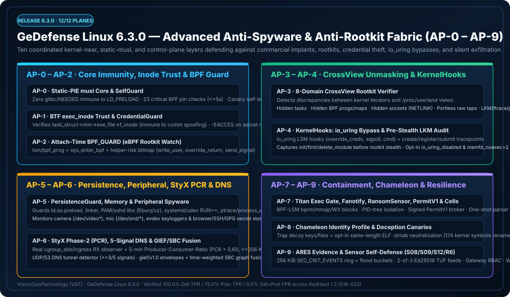
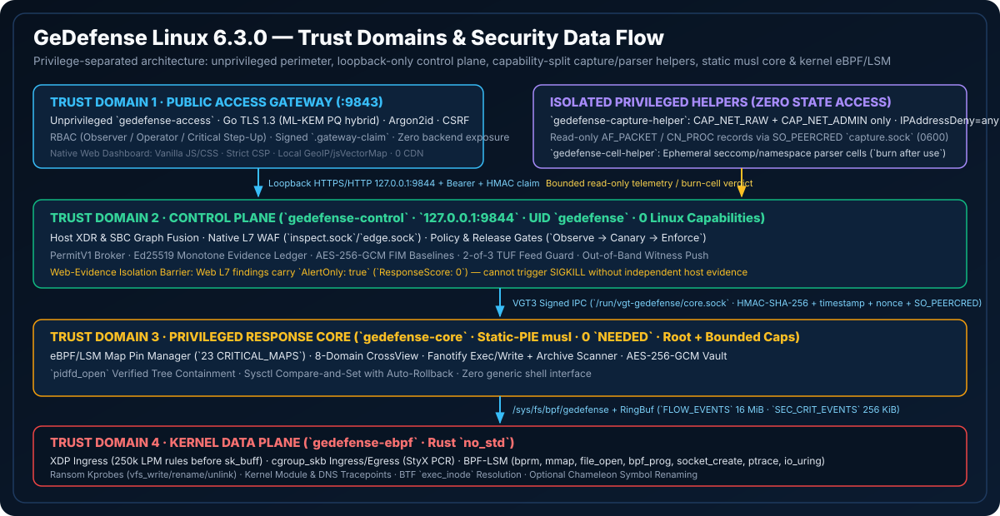

<div align="center">


# VGT GeDefense Linux `6.3.0` — *GeDefense Vasili Edition*
### Souveräne lokale Linux Security Fabric & Anti-Spyware Defense — Your Entenprise System

[](https://www.gnu.org/licenses/agpl-3.0)
[](RELEASE-NOTES.md)
[](RELEASE-NOTES.md)
[-brightgreen?style=for-the-badge)](RELEASE-NOTES.md)
[](docs/INSTALLATION.md)
[](docs/ARCHITECTURE.md)
[](docs/ARCHITECTURE.md)
[](docs/ANTISPYWARE.md)
[](docs/SECURITY-MODEL.md)
[](benchmarks/vgt-hardred-6.3.0/)
[](benchmarks/vgt-hardred-6.3.0/hardred/)
[](https://visiongaiatechnology.de)

**KERNELNAHE NETZWERKVERTEIDIGUNG · HOST-XDR · `AP-0`–`AP-9` ANTI-SPYWARE · VERSCHLÜSSELTE EVIDENZ · REVERSIBLE HÄRTUNG · KEINE CLOUD-CONTROL-PLANE**


<br />

🌐 **Languages / Sprachen / Языки / 语言:**  
[English](README.md) · **Deutsch** · [Русский](README.ru.md) · [中文 (简体)](README.zh.md)

<br />

⬇️ **Offizielle v6.3.0 Installer & Nachweise:**  
[**OneClick-Installer (`.run`)**](https://github.com/visiongaiatechnology/gedefense/releases/download/v6.3.0/VGT_GeDefense_V6_6.3.0_OneClick.run) · [`.sha256`](https://github.com/visiongaiatechnology/gedefense/releases/download/v6.3.0/VGT_GeDefense_V6_6.3.0_OneClick.run.sha256) · [**Desktop Tray (`.run`)**](https://github.com/visiongaiatechnology/gedefense/releases/download/v6.3.0/GeDefense-6.3.0-Desktop-OneClick.run) · [`.sha256`](https://github.com/visiongaiatechnology/gedefense/releases/download/v6.3.0/GeDefense-6.3.0-Desktop-OneClick.run.sha256) · [**Quellarchiv (`.zip`)**](https://github.com/visiongaiatechnology/gedefense/releases/download/v6.3.0/VGT_GeDefense_V6_6.3.0_Source.zip) · [**Release v6.3.0**](https://github.com/visiongaiatechnology/gedefense/releases/tag/v6.3.0) · [**Benchmarks (`6.3.0`)**](benchmarks/vgt-hardred-6.3.0/)

<br />


</div>

---

## 01 · Schnellnavigation

| Bereich | Inhalt | Link |
|---|---|---|
| 02 · **Executive Overview** | Souveräne Linux Security Fabric & Produktionsreife | [Überblick](#02--executive-overview) |
| 03 · **Neu in 6.3.0** | `AP-0`–`AP-9` Anti-Spyware, Kernelschutz & Refactoring | [Anti-Spyware-Doku](docs/ANTISPYWARE.md) |
| 04 · **Kernfunktionen** | XDP-Netzwerk, L7-WAF, XDR, Ransomware-Vault, Evidenz | [Kernfunktionen](#04--kernfunktionen) |
| 05 · **Sicherheitsarchitektur** | 7-Stufen-Vertrauensdomänen, Datenflüsse & Isolationsbarriere | [Architektur-Übersicht](docs/ARCHITECTURE.md) |
| 06 · **Benchmark-Ergebnisse** | HardRed `1.2` (`94,95`), ARES `1.2`, Anti-Spyware `S16–S20` & HardRed `1.3` (`90,09`) | [Benchmark-Paket](benchmarks/vgt-hardred-6.3.0/) |
| 07 · **Verifikation & Evidenz** | Testberichte, Dashboards, CSV/SARIF/OCSF & lokale Audits | [Verifikation](#07--verifikation--evidenz) |
| 08 · **Installation** | Systemanforderungen, signierte `.run`-Installer & Rollback | [Installationshandbuch](docs/INSTALLATION.md) |
| 09 · **Konfiguration & Betrieb** | `Observe`, `Canary`, `Enforce`, `Degraded` & Emergency Stop | [Konfigurationshandbuch](docs/CONFIGURATION.md) |
| 10 · **Sicherheitsmodell & Grenzen** | Vertrauensgrenzen, Voraussetzungen & verifizierte `6.3.0`-Grenzen | [Sicherheitsmodell](docs/SECURITY-MODEL.md) |
| 11 · **Entwickler- & Forschungsressourcen** | Vollständiger Dokumentations-Index & GeDefense-Ökosystem | [Entwicklerhandbuch](docs/DEVELOPER-GUIDE.md) |
| 12 · **Release-Historie** | Kompakte Versionshistorie (`6.3.0` → `1.0.0`) | [CHANGELOG.md](CHANGELOG.md) |
| 13 · **Lizenz & Attribution** | `AGPL-3.0-only` & Drittanbieter-Lizenzen | [THIRD-PARTY-LICENSES.md](THIRD-PARTY-LICENSES.md) |

---

## 02 · Executive Overview

**GeDefense Linux `6.3.0`** ist eine **lokal souveräne Linux Security Fabric** — kernelnahe Netzwerkverteidigung per eBPF/XDP, native Go-Layer-7-WAF-Inspektion, Host-Behavioral-XDR, 10-stufiger Anti-Spyware- und Anti-Rootkit-Schutz (`AP-0`–`AP-9`), reversible Sysctl-Härtung (Compare-and-Set) und ein Ed25519-signiertes Forensik-Ledger in einem System — **ohne Cloud-Control-Plane**.

```text
Konventionelle Sicherheits-Stacks (iptables + auditd + fail2ban + WAF-Proxy + Cloud-SIEM)
  Unkoordinierte Daemons  -> fragmentierter Zustand, ~1,8–2,5 GiB RAM, träge Reaktionen
  Config-as-Trust         -> einzelne Muster erzeugen False-Positive-Lockouts
  Cloud-Telemetrie        -> sensible Hostdaten und Zugangsdaten verlassen die Maschine

VGT GeDefense Linux 6.3.0
  Rust no_std eBPF/XDP + BPF-LSM   -> droppt Pakete & blockt unbefugte Syscalls im Kernel
  Static-PIE musl Core (UID 0)     -> immun gegen LD_PRELOAD, pidfd-Isolation, AES-GCM Vault
  Loopback Go Control Plane (0 Cap)-> XDR/SBC-Korrelation, L7 AlertOnly WAF, FIM, TUF-Feeds
  Ed25519 + AES-256-GCM Ledger     -> manipulationssichere Evidenz & Rollback (~70,8 MiB RSS)
```

> [!IMPORTANT]
> **Produktionsreife & Zielhost-Qualifikation (`6.3.0`):**  
> GeDefense Linux `6.3.0` ist ein vollständig auditiertes, durch reproduzierbare Benchmarks verifiziertes **Production-Candidate-Release**. Jedes Release liefert kryptografische Provenance (`SHA256SUMS`, SPDX SBOM, signiertes Manifest/Index), bestandene Go-/Rust-Testsuiten, das 10-stufige statische Sicherheitsaudit und verifizierte HardRed-`1.2`/`1.3`- sowie ARES-Auswertungen (`PASS`). Auf dem Zielsystem startet GeDefense immer sicher im Modus `observe`; vor Aktivierung von `enforce` müssen Zielkernel (`lsm=...,bpf`), NIC-XDP-Modus, Systemd-Units, IPC und die Management-Allowlist qualifiziert sowie [`SECURITY.md`](SECURITY.md) geprüft werden.

---

## 03 · Neu in `6.3.0`

### 🛡️ Advanced Anti-Spyware & Anti-Rootkit Protection (`AP-0` – `AP-9`)

> **GeDefense Linux 6.3.0 · Release-Schwerpunkt:** Schutz gegen moderne Linux-Implantate (*Symbiote*, *OrBit*, *Ebury*, *LinkPro*, *VoidLink*, *BPFDoor*, *PUMAKIT*, *Curing*-`io_uring`), Kernel-Manipulation, Credential Access, Prozessversteckung und heimliche Datenexfiltration — aktiv über **12/12 koordinierte Schutzebenen**.

| Gruppe | Schutzebenen | Schwerpunkt |
|---|---|---|
| **`AP-0 – AP-2`** | `SelfGuard`, `CredentialGuard`, `BPF_GUARD` | Static-PIE musl Immunität (`0 NEEDED`), BPF Pin/Canary Watch, BTF `exec_inode` Trust & Helper-Risk-Bitmap |
| **`AP-3 – AP-4`** | `CrossView`, `KernelHooks` | 8-Domänen Rootkit-Widerspruchsprüfung, `io_uring` LSM/Tracepoints & Pre-Stealth LKM-Audit |
| **`AP-5 – AP-6`** | `PersistenceGuard`, `StyX PCR`, `DNS Detection` | Linker/PAM/systemd/Peripherie/Memory-Schutz, `cgroup_skb/ingress` PCR (`>0,60`), 5-Signal-DNS & `GIEF/SBC` |
| **`AP-7 – AP-9`** | `Titan Exec`, `Chameleon`, `Evidence Resilience` | `Fanotify` + `RansomSensor`, `PermitV1`, `Parser Cells`, 174-Symbol-Chameleon-Profil, `S09`/`S12`/`R6`/`S08` |

<div align="center">
  
</div>

#### Kurzüberblick über alle zehn Schutzebenen

1. **`AP-0` — Static-PIE musl Core & `SelfGuard`:** Kompiliert `gedefense-core` statisch ohne glibc (`0 NEEDED`), schließt `LD_PRELOAD`-Angriffe gegen den Core aus, prüft alle **23 `CRITICAL_MAPS`** Pins (`<= 5 s`) und meldet Manipulationen über `XDR.SELF_TAMPER` vorrangig an den externen Witness.
2. **`AP-1` — BTF `exec_inode` Trust & `CredentialGuard`:** Entscheidet über die echte Kernel-Binary-Identität (`task_struct -> mm -> exe_file -> f_inode`), nicht über fälschbare `comm`-Namen — sperrt unbefugte Zugriffe auf `/etc/shadow` & Secrets hart per `-EACCES`.
3. **`AP-2` — Attach-Time `BPF_GUARD`:** Überwacht `lsm/bpf_prog`, `sys_enter_bpf` und `check_helper_call` auf riskante Kernel-Helper (`bpf_probe_write_user`, `bpf_override_return`, `bpf_send_signal`).
4. **`AP-3` — 8-Domänen `CrossView` Verifier:** Enttarnt versteckte Prozesse, versteckte eBPF-Programme/Maps, versteckte Sockets (`NETLINK_SOCK_DIAG`), portlose Raw-Taps, versteckte LKMs, Ftrace-Hooks, Pin-Abweichungen (inkl. 15-Zeichen `BPF_OBJ_NAME_LEN`-Matching) und Paket-DB-Bibliotheksabweichungen.
5. **`AP-4` — `KernelHooks` (`io_uring` & LKM-Audit):** Überwacht asynchrone `io_uring`-Operationen (`uring_override_creds`/`sqpoll`/`cmd` + Tracepoints) sowie Modul-Ladevorgänge (`init_module`/`finit_module`/`delete_module`) noch vor einem Rootkit-Stealth-Hiding.
6. **`AP-5` — `PersistenceGuard` & Peripherieschutz:** Schützt `/etc/ld.so.preload`, Dynamic-Linker, PAM/`sshd`-Libraries, systemd-Units/Generatoren, `udev RUN+=`, Prozessspeicher (`ptrace`/`process_vm_readv` inkl. sauberer Unterscheidung zu legitimen Root-`PTRACE_MODE_NOAUDIT`-Statuslesern) sowie Kamera, Mikrofon und `evdev`-Keylogger.
7. **`AP-6` — `StyX Phase-2` (PCR), DNS-Tunneling & `GIEF / SBC Fusion`:** Reale `cgroup_skb/ingress`-RX-Beobachtung (`PCR > 0,60`, `>= 256 KiB`), 5-Signal-DNS-Tunnelanalyse (`>= 3` gleichzeitige Signale), `gief/v1.0`-Envelopes und zeitgewichteter SBC-Entitätsgraph.
8. **`AP-7` — `Titan Exec Gate`, `Fanotify`, `RansomSensor`, `PermitV1` & `Parser Cells`:** Synchroner/asynchroner Dateiscan, Kernel-`WX`-Sperren, `pidfd`-Prozessbaum-Isolation (schützt Web-Worker-Pools wie `php-fpm`), signierte `PermitV1`-Ausnahmen und Wegwerf-Parserzellen.
9. **`AP-8` — `Chameleon` Identity Mode & Deception Canaries:** Köder-Dateien plus optionales signiertes Profil zur längengleichen Umbenennung von **174 eBPF-Kernelsymbolen** beim Laden (`bpftool` zeigt keine `gedefense`/`styx`/`titan`-Namen) mit Step-Up-Reveal für Admins.
10. **`AP-9` — `ARES`-Selbstverteidigung:** Unabhängiger **256-KiB-`SEC_CRIT_EVENTS`** High-Priority-Ring gegen Log-Flooding (`S12` inkl. Multi-CPU-SMP-Toleranz), 2-aus-3-Ed25519-TUF-Feeds (`S09`), Gateway-RBAC (`Observer`/`Operator`/`Critical Unlock`, `R6`) und Witness-Prioritätspush (`S08`/`S15`).

> 📘 **Vollständige technische Spezifikation (`AP-0`–`AP-9`, Live-API & S16–S20-Mapping):** [**`docs/ANTISPYWARE.md`**](docs/ANTISPYWARE.md)

### Weitere Neuerungen in `6.3.0`
- **5-Wellen-Refactoring:** Modulare Codebasis über Go (`control/`, `gateway/`), Web-UI, Rust Core/eBPF und das 10-stufige Sicherheitsaudit ([`docs/REFACTORING-V6.3.0.md`](docs/REFACTORING-V6.3.0.md)).
- **Post-Release Kernel- & Pool-Härtungen:** Panel-PHP-FPM-Worker-Pool-Isolation, `sec_crit` SMP-Clock-Skew-Fix, dynamische `StyX`-Local-Host-Maskierung + `ksoftirqd`-Anti-Spoof, 15-Zeichen-BPF-Namen-Abgleich in `cross_view` und FP-freies Root-`NOAUDIT`-Procfs-Status-Handling.
- **Performance-Steigerung:** **`648,8 HTTP RPS`** (`20,59 ms` p95) bei nur **`70,8 MiB` RSS** und **`7,1 %` CPU** ([`docs/PERFORMANCE.md`](docs/PERFORMANCE.md)).

---

## 04 · Kernfunktionen

| Ebene | Fähigkeiten | Doku |
|---|---|---|
| **Netzwerk (eBPF/XDP)** | XDP-Drops vor `sk_buff` (250k LPM-Regeln, IPv4/IPv6), Kinetic Flood/Portscan-Abwehr, Management-Allowlist-Vorrang, `VERIFY_EMPTY` | [`docs/ARCHITECTURE.md`](docs/ARCHITECTURE.md) |
| **Native L7-WAF & Module A–E** | Zero-Dep-Go L7 HTTP/Raw-Body-WAF, Web Exposure ELF-Scan, Worker Crash-Storm Guard, isolierter TLS/ALPN `capture-helper`, LPE Socket-Blocker, Edge Proxy | [`docs/ARCHITECTURE.md`](docs/ARCHITECTURE.md) |
| **Host-XDR & Anti-Spyware** | 10 Ebenen (`AP-0`–`AP-9`), `CrossView` 8-Domänen-Abgleich, `io_uring`-Hooks, `StyX` Cgroup Egress/PCR, 5-Signal-DNS, `GIEF/SBC` Graph | [`docs/ANTISPYWARE.md`](docs/ANTISPYWARE.md) |
| **Ransomware & Malware Vault** | `vfs_write`/`rename`/`unlink` Entropie- & Rename-Storm-Stopp, `FAN_OPEN_EXEC_PERM` + `FAN_CLOSE_WRITE` Tiefe-8-Archivscan, `MALWARE_DENIED_INODES`, AES-256-GCM Vault | [`docs/SECURITY-MODEL.md`](docs/SECURITY-MODEL.md) |
| **Evidenz & Härtung** | Ed25519-signiertes Ledger, AES-GCM-FIM + `ChronosScanner`, Compare-and-Set Sysctls (`astraeaos-cis-l1`) mit Auto-Rollback, externer Witness | [`docs/CONFIGURATION.md`](docs/CONFIGURATION.md) |

---

## 05 · Sicherheitsarchitektur

<div align="center">
  
</div>

### Architekturelle Kerninvarianten
- **Strikte Vertrauensdomänen (`4` Domänen, `7` Stufen):** Unprivilegierter HTTPS-Gateway (`:9843`) → Capability-freie Loopback Control Plane (`:9844`, `UID gedefense`) + isolierte Helper (`capture-helper` ohne Secret-/Config-Zugriff, ephemerer `cell-helper`) → Static-PIE musl Core (`UID 0`) → Rust `no_std` Kernel Data Plane.
- **Web-Evidence-Isolationsbarriere:** HTTP-/L7-Treffer tragen zwingend `AlertOnly: true` (`ResponseScore: 0`) — eine Web-Regel kann niemals eigenständig `SIGKILL`/`XDR_KILL_TREE` ohne unabhängige Host-/Kernel-Evidenz auslösen.
- **Universal Linux & AstraeaOS:** Läuft auf APT, DNF/YUM, pacman und Zypper sowie als alleinige Sicherheitsautorität nativ in AstraeaOS.

> 📘 **Architektur-Spezifikationen:** [`docs/ARCHITECTURE.md`](docs/ARCHITECTURE.md) · [`ARCHITECTURE.md` (Vollreferenz, 4.400+ Zeilen)](ARCHITECTURE.md)

---

## 06 · Benchmark-Ergebnisse (`VGT HardRed` & `REDHARD ARES`)

> [!NOTE]
> **Methodik & Transparenzhinweis:**  
> Alle Messungen wurden mit dem Open-Source-Framework **[VGT HardRed (`RedHard`)](https://github.com/visiongaiatechnology/redhard)** auf Snapshot-isolierten **Ubuntu 24.04 (Linux HWE 7.0, 4 vCPU, 4 GiB RAM, NGINX + PHP 8.3-FPM)** Ziel-VMs erhoben. **HardRed und ARES sind VGT-eigene, reproduzierbare Benchmark-Evaluationen** mit streng objektiven Kriterien — **keine unabhängige Drittanbieter-Zertifizierung**.

### A. `HardRed 1.2` & `1.3` — Standard Security Benchmark

| Benchmark-Suite | Geprüfte Version | Overall Score | Achse 1: Effektivität | Achse 2: FP-Resilienz | Achse 3: Latenz | Achse 4: Overhead | Gate |
|---|---|---:|---:|---:|---:|---:|---|
| **HardRed 1.2** *(Basis-Suite S01–S15)* | GeDefense `6.2.1` | `94,73` | `95,88` | `100,00` | `92,20` | `87,63` | **`PASS`** |
| **HardRed 1.2** *(Basis-Suite S01–S15)* | **GeDefense `6.3.0`** | **`94,95`** | **`96,73`** | **`100,00`** | `88,87` | **`91,00`** | **`PASS`** |
| **HardRed 1.3** *(+ `S16–S20` & Pipe-Clock-Fix)* | **GeDefense `6.3.0` (`03j`)** | **`90,09`** | `90,06` | `85,71` *(0 % Prot-FP)* | **`89,90`** | **`96,27`** | **`PASS`** |

<details>
<summary><strong>Vollständiger 7-System-Vergleich (HardRed 1.3 · Alle Domänen + Anti-Spyware S16–S20)</strong></summary>

| Rang | Sicherheitssystem | Gesamt | Scope Coverage | In-Scope Eff. | Effektivität | FP-Resilienz | Latenz | Overhead | Gate |
|---:|---|---:|---:|---:|---:|---:|---:|---:|---|
| 1 | **GeDefense Linux 6.3.0 (`03j`)** | **90,09** | 100,0 % | 90,06 | 90,06 | 85,71 | 89,90 | 96,27 | **`PASS`** |
| 2 | **OSS Best-of-Breed + SafeLine WAF** | **56,41** | 90,9 % | 55,02 | 55,02 | 100,00 | 36,39 | 29,17 | `PASS` |
| 3 | **Chaitin SafeLine WAF CE 9.4.7** | **50,41** | 45,5 % | 56,79 | 35,78 | 100,00 | 27,69 | 58,50 | `PASS` |
| 4 | **OSS Best-of-Breed** (`ModSec+Suricata+Tetragon+ClamAV`) | **47,87** | 90,9 % | 67,98 | 67,98 | 42,86 | 38,40 | 6,83 | `FAIL` |
| 5 | **Wazuh** (`Rules+FIM+Auditd+Active Response`) | **47,72** | 81,8 % | 35,90 | 35,90 | 71,43 | 28,28 | 77,47 | `CONDITIONAL` |
| 6 | **CrowdSec** (`Max Collections+Bouncers+AppSec`) | **24,73** | 36,4 % | 51,66 | 31,77 | 0,00 | 18,53 | 44,88 | `FAIL` |
| Ref | **Baseline** (`Clean Ubuntu HWE 7.0 WebStack`) | **46,01** | 100,0 % | 17,20 | 17,20 | 100,00 | 16,37 | 100,00 | `CONDITIONAL` |

</details>

### B. `ARES 1.2` & `1.3` — Adaptive Adversarial Evaluation

| Säule | GeDefense `6.2.1` (`ARES 1.2`) | GeDefense `6.3.0` (`ARES 1.2`) | GeDefense `6.3.0` (`ARES 1.3 · S01–S20`) |
|---|---:|---:|---:|
| **Design Resilience** (`R1`–`R12`) | `78,40` | **`86,90`** | **`86,90`** |
| **Runtime Resilience** | `96,68` | **`96,68`** | **`96,52`** |
| **Adaptive Adversarial Resilience** | `93,46` | **`93,46`** | **`87,70`** |
| **Selbstschutz** (`R5`, `R6`, `R7`) | `73,12` | **`90,00`** | **`90,00`** |
| **Unterbrochene Ketten / Pre-Kill Damage / FP** | `36/36` · `11,1 %` · `0` | `36/36` · `11,1 %` · `0` | **`54/54` · `11,6 %` · `0`** (`264/267` Codezitate) |

### C. `HardRed 1.3` / `ARES` Anti-Spyware-Kampagnen (`S16` – `S20`)

Prüft **Kernel/eBPF (`S16`)**, **Async `io_uring` (`S17`)**, **Credential-/Prozessspeicher (`S18`)**, **CrossView-Maskierung/`LD_PRELOAD`/Raw-Tap (`S19`)** sowie **Selbstschutz + 200-Event-Burst (`S20`)**:

| System | Domänen-Score | Det TPR | Prev TPR | Det / Prot FPR | Median TTFA (ms) | `S16` (eBPF/LKM) | `S17` (`io_uring`) | `S18` (Cred/Mem) | `S19` (CrossView) | `S20` (Self-Integrity) |
|---|---:|---:|---:|---:|---:|---|---|---|---|---|
| **GeDefense Linux 6.3.0 (`03j`)** | **84,8** | **100,0 %** | **75,0 %** | **0,0 % / 0,0 %** | **1010,9** | `DETECTED_ONLY` | `DETECTED_ONLY` | **`PREVENTED`** | **`PREVENTED`** | **`PREVENTED`** |
| **Wazuh HIDS/SIEM** | 44,2 | 80,0 % | 0,0 % | 0,0 % / 0,0 % | 613,3 | `DETECTED_ONLY` | `DETECTED_ONLY` | `DETECTED_ONLY` | `DETECTED_ONLY` | `NO_DETECTION` |
| **OSS + SafeLine WAF** | 32,5 | 40,0 % | 0,0 % | 0,0 % / 0,0 % | 408,0 | `NO_DETECTION` | `NO_DETECTION` | `DETECTED_ONLY` | `DETECTED_ONLY` | `NO_DETECTION` |
| **OSS Best-of-Breed** | 32,5 | 40,0 % | 0,0 % | 0,0 % / 0,0 % | 421,9 | `NO_DETECTION` | `NO_DETECTION` | `DETECTED_ONLY` | `DETECTED_ONLY` | `NO_DETECTION` |
| **Chaitin SafeLine WAF** | 7,5 | 0,0 % | 0,0 % | 0,0 % / 0,0 % | — | `NOT_IN_SCOPE` | `NOT_IN_SCOPE` | `NOT_IN_SCOPE` | `NOT_IN_SCOPE` | `NO_DETECTION` |
| **CrowdSec IPS/AppSec** | 7,5 | 0,0 % | 0,0 % | 0,0 % / 0,0 % | — | `NOT_IN_SCOPE` | `NOT_IN_SCOPE` | `NOT_IN_SCOPE` | `NOT_IN_SCOPE` | `NO_DETECTION` |
| **Baseline (Ungeschützt)** | 7,5 | 0,0 % | 0,0 % | 0,0 % / 0,0 % | — | `NO_DETECTION` | `NO_DETECTION` | `NO_DETECTION` | `NO_DETECTION` | `NO_DETECTION` |

---

## 07 · Verifikation & Evidenz

- 📁 **Vollständiges `6.3.0`-Nachweispaket:** [`benchmarks/vgt-hardred-6.3.0/`](benchmarks/vgt-hardred-6.3.0/)
  - [`hardred/`](benchmarks/vgt-hardred-6.3.0/hardred/) (`1.2` & `1.3` CSVs) · [`ares/`](benchmarks/vgt-hardred-6.3.0/ares/) (`ARES 1.2` & `1.3`) · [`antispyware/`](benchmarks/vgt-hardred-6.3.0/antispyware/) (`S16–S20`-Matrix)
  - [`reports/`](benchmarks/vgt-hardred-6.3.0/reports/) (`FINAL_BENCHMARK_REPORT_1.3.md`, `VGT_HardRed_Dashboard.html`, `VGT_HardRed_ARES_Dashboard.html`)
  - [`raw-evidence/`](benchmarks/vgt-hardred-6.3.0/raw-evidence/) (Alle 7 `scorecard.json`, `meta.json`, `.sarif.json`, `.ocsf.json`, ATT&CK-Layer, GoTestWAF-Berichte & `ares_campaign`-Exporte)

**Tests & Sicherheitsaudit lokal ausführen:**
```bash
make test           # Go Unit-/Integrationstests + go vet + JS-Syntax + 10-Stufen-Audit
make test-race      # Go Race-Detector (control + gateway)
make fuzz-smoke     # 24 Security-Fuzz-Targets (IPC, L7, TUF, Witness, AP-0..AP-9)
make rust           # Native Rust-Tests (common/core) + static-PIE musl + eBPF-Build
bash scripts/validate.sh
```

---

## 08 · Installation

**Voraussetzungen:** Linux `x86_64`, `systemd`, `apt`/`dnf`/`pacman`/`zypper`, `libargon2.so.1`, eBPF/XDP-fähiger Kernel (`lsm=...,bpf` empfohlen für volle BPF-LSM-Erzwingung).

```bash
wget https://github.com/visiongaiatechnology/gedefense/releases/download/v6.3.0/VGT_GeDefense_V6_6.3.0_OneClick.run
wget https://github.com/visiongaiatechnology/gedefense/releases/download/v6.3.0/VGT_GeDefense_V6_6.3.0_OneClick.run.sha256
sha256sum --check VGT_GeDefense_V6_6.3.0_OneClick.run.sha256
chmod 0700 VGT_GeDefense_V6_6.3.0_OneClick.run
sudo ./VGT_GeDefense_V6_6.3.0_OneClick.run
```

> 📘 **Desktop-Tray-`.run`, Source-Build, Dateipfade & Rollback:** [`docs/INSTALLATION.md`](docs/INSTALLATION.md)

---

## 09 · Konfiguration & Betrieb

GeDefense startet konservativ in **`observe`** und steuert aktive Abwehr strikt über Promotion-Gates (`observe → canary → enforce`), synchronisierte Management-Allowlists und reversible Transaktionen:

| Phase | Netzwerk-Zustand | Host- / Prozessreaktion | Freigabebedingung |
|---|---|---|---|
| **Observe** | XDP aktiv, Blockliste leer (`VERIFY_EMPTY`) | Nur Telemetrie-Aufzeichnung | Authentifizierte Core-IPC + signierte Observe-Policy |
| **Canary** | Netzwerk weiter Observe | Evidenzgeprüftes `SIGSTOP` (`AlertOnly` Web) | Geprüfte Policy + Soak-Gate + gesundes XDR |
| **Enforce** | Signierte XDP-LPM-Blockregeln | Broker-geprüftes `pidfd` `SIGKILL` / Vault | Nicht-leere, synchronisierte Management-Allowlist |
| **Degraded** | Fail-Safe / unbestätigt | Aktive Reaktionen ausgesetzt | Sichtbare Operator-Wiederherstellung |

> 📘 **Promotion-Befehle, Emergency Stop & `EDR/Hardened Max`-Profil:** [`docs/CONFIGURATION.md`](docs/CONFIGURATION.md)

---

## 10 · Sicherheitsmodell & Grenzen

- **Schlüssel- & Vertrauensgrenzen:** Private Release-Signing-Keys bleiben offline außerhalb des Repos (`RELEASE-KEYS.md`); lokale Laufzeit-Schlüssel liegen mit `0600` unter `/etc/vgt/gedefense` und `/var/lib/vgt/gedefense`.
- **Kernel-`bpf`-LSM-Abhängigkeit:** Aktive BPF-LSM-Sperren (`Titan Exec Gate`, `CredentialGuard`, `BPF_GUARD`) erfordern `bpf` in `/sys/kernel/security/lsm`; fehlt diese Flag, meldet GeDefense ehrlich `inactive`.
- **Verifizierte `6.3.0`-Einschränkungen:** Keine Swarm-/Mesh-Koordination, kein QUIC-Offloading und keine TLS-MITM-Entschlüsselung, kein Ersatz für Provider-DDoS-Kapazitäten, keine Garantie nach bereits erfolgter uneingeschränkter Root-Kernel-Kompromittierung. `AS-S16` (eBPF/LKM) und `AS-S17` (`io_uring`) arbeiten standardmäßig als `DETECTED_ONLY` (hartes System-Disablement per `kernel.io_uring_disabled` bleibt Opt-in), `Feed Auto-Enforce`, `Emergency Lockdown`, `Witness` & `Chameleon` bleiben Opt-in, und die WordPress-Bridge ist Alpha-Vorschau ([`SECURITY.md`](SECURITY.md)).

> 📘 **Vollständiges Sicherheitsmodell & bekannte Grenzen:** [`docs/SECURITY-MODEL.md`](docs/SECURITY-MODEL.md) · [`SECURITY.md`](SECURITY.md)

---

## 11 · Entwickler- & Forschungsressourcen

| Ressource | Zweck | Link |
|---|---|---|
| **Architektur & Spezifikation** | Vertrauensdomänen & 4.400-Zeilen-Gesamtspezifikation | [`docs/ARCHITECTURE.md`](docs/ARCHITECTURE.md) · [`ARCHITECTURE.md`](ARCHITECTURE.md) |
| **Anti-Spyware-Spezifikation** | Technische `AP-0`–`AP-9`-Referenz & Live-API | [`docs/ANTISPYWARE.md`](docs/ANTISPYWARE.md) |
| **Sicherheitsmodell** | Kryptografie, Invarianten & `6.3.0`-Grenzen | [`docs/SECURITY-MODEL.md`](docs/SECURITY-MODEL.md) · [`CRYPTOGRAPHY.md`](CRYPTOGRAPHY.md) |
| **API & Betrieb** | RBAC-Rollen, `/api/v1/*`-Endpunkte & Konfiguration | [`docs/API-REFERENCE.md`](docs/API-REFERENCE.md) · [`docs/CONFIGURATION.md`](docs/CONFIGURATION.md) |
| **Performance & Analyse** | Overhead-Messwerte & Diagnose-Playbook | [`docs/PERFORMANCE.md`](docs/PERFORMANCE.md) · [`docs/TROUBLESHOOTING.md`](docs/TROUBLESHOOTING.md) |
| **Entwickler & QA-Gates** | Tests, Fuzzing, Reproducible Releases & Beta-Plan | [`docs/DEVELOPER-GUIDE.md`](docs/DEVELOPER-GUIDE.md) · [`BETA-TEST-PLAN.md`](BETA-TEST-PLAN.md) |

### Das GeDefense-Ökosystem

| Plattform | Schwerpunkt | Repository |
|---|---|---|
| **GeDefense Linux** *(dieses Repository)* | Kernel eBPF/XDP, L7-WAF, Host-XDR, `AP-0`–`AP-9` Anti-Spyware | [`visiongaiatechnology/gedefense`](https://github.com/visiongaiatechnology/gedefense) |
| **GeDefense Windows** | Lokale souveräne Windows-11-Konsole, Defender/ASR/WFP & MHX EDR | [`visiongaiatechnology/gedefensewin`](https://github.com/visiongaiatechnology/gedefensewin) |
| **GeDefense Android** | Lokale VPN-Durchsetzung, Endpoint-Telemetrie & XDR/EDR | [`visiongaiatechnology/gedefenseandroid`](https://github.com/visiongaiatechnology/gedefenseandroid) |
| **GeDefense Android TV** | Android-TV / Google-TV Sicherheitskonsole & Kinetic-Lite | [`visiongaiatechnology/gedefense_androidtv`](https://github.com/visiongaiatechnology/gedefense_androidtv) |
| **GeDefense WordPress** | AGPL-3.0 WP-Schutzsuite (ZEUS WAF, AEGIS, TRINITY XDR, HADES) | [`visiongaiatechnology/gedefensewp`](https://github.com/visiongaiatechnology/gedefensewp) |

---

## 12 · Release-Historie

| Release | Datum | Meilenstein-Zusammenfassung | Details |
|---|---|---|---|
| **`v6.3.0`** *(Aktuell)* | `2026-11-26` | `AP-0`–`AP-9` Anti-Spyware, 5-Wellen-Refactoring, Kernel-/Pool-Fixes, HardRed `1.2` (`94,95`) & `1.3` (`90,09 · PASS`) + ARES `1.3` | [`CHANGELOG.md`](CHANGELOG.md) · [`RELEASE-NOTES.md`](RELEASE-NOTES.md) |
| `v6.2.1` | `2026-11-23` | `MALWARE_DENIED_INODES` BPF-LSM-Lock, Kernel Behavioral XDR, Worker-Pool-Isolation (`94,73 · PASS`) | [`docs/V6.2.1-RELEASE.md`](docs/V6.2.1-RELEASE.md) |
| `v6.2.0` | `2026-11-22` | `FAN_CLOSE_WRITE` Vault, Titan Exec Gate `untrusted`, eBPF RansomSensor (`86,16 · PASS`) | [`docs/V6.2.0-RELEASE.md`](docs/V6.2.0-RELEASE.md) |
| `v6.1.0` – `v6.1.2` | `2026-11-18..20` | Module A–E (Exposure, WorkerGuard, TLS, LPE, Edge), isolierter `capture-helper`, Kernel 7.3 BTF | [`docs/V6.1.2-HOTFIX.md`](docs/V6.1.2-HOTFIX.md) |
| `v6.0.0` – `v6.0.3` | `2026-11-15..17` | 5-Punkte-Souveränitätsarchitektur (StyX, Titan, Parser Cells, Witness, Emergency Lockdown) | [`CHANGELOG.md`](CHANGELOG.md) |

---

## 13 · Lizenz & Attribution

GeDefense Linux steht unter **`AGPL-3.0-only`** ([`LICENSE`](LICENSE)). Enthaltenen Drittanbieter-Bibliotheken und öffentlichen Datensätzen gelten ihre jeweiligen eigenen Lizenzen (vollständige Texte in [`THIRD-PARTY-LICENSES.md`](THIRD-PARTY-LICENSES.md)):

| Komponente / Datensatz | Quelle | Lizenz |
|---|---|---|
| **jsVectorMap 1.7.0** (lokale Dashboard-Weltkarte) | [themustafaomar/jsvectormap](https://github.com/themustafaomar/jsvectormap) | **MIT** © 2020 Mustafa Omar |
| **IP-to-Country / IP-to-ASN** (`geoip.csv` offline) | [iplocate/ip-address-databases](https://github.com/iplocate/ip-address-databases) | **CC BY-SA 4.0** (von VGT für GeDefense transformiert; Weitergabe CC BY-SA 4.0) |
| **DB-IP Lite** (City-GeoIP-Daten für Updater) | [db-ip.com](https://db-ip.com/) | **CC BY 4.0** (Namensnennung erforderlich) |
| **Origin-ASN-Daten** (Updater-Quelle) | [sapics/ip-location-db](https://github.com/sapics/ip-location-db) | **PDDL** |
| **Qt 6** (optionaler Desktop-Tray, dynamisch gelinkt) | [qt.io](https://www.qt.io/) | **LGPL-3.0** / kommerzielle Qt-Bedingungen |

*Es werden zur Laufzeit keine CDNs oder externen Cloud-Abfragen genutzt.*
