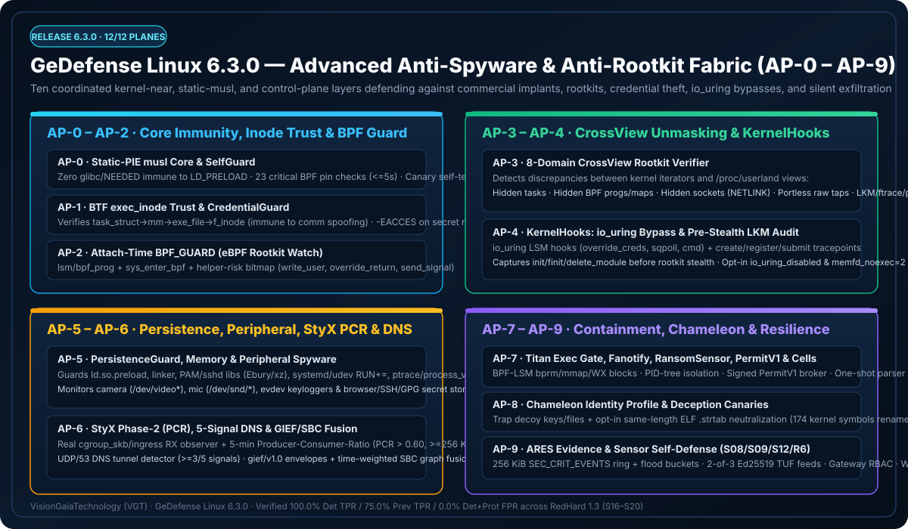
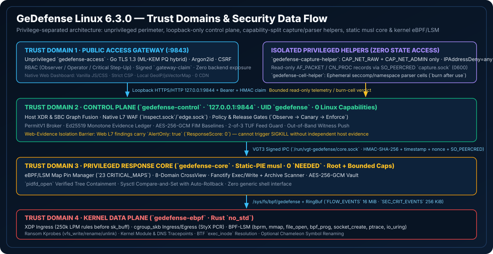

<div align="center">


# VGT GeDefense Linux `6.3.0` — *GeDefense Vasili Edition*
### Local Sovereign Linux Security Fabric & Anti-Spyware Defense — Your Entenprise System

[](https://www.gnu.org/licenses/agpl-3.0)
[](RELEASE-NOTES.md)
[](RELEASE-NOTES.md)
[-brightgreen?style=for-the-badge)](RELEASE-NOTES.md)
[](docs/INSTALLATION.md)
[](docs/ARCHITECTURE.md)
[](docs/ARCHITECTURE.md)
[](docs/ANTISPYWARE.md)
[](docs/SECURITY-MODEL.md)
[](benchmarks/vgt-hardred-6.3.0/)
[](benchmarks/vgt-hardred-6.3.0/hardred/)
[](https://visiongaiatechnology.de)

**KERNEL-NEAR NETWORK DEFENSE · HOST XDR · `AP-0`–`AP-9` ANTI-SPYWARE · ENCRYPTED EVIDENCE · REVERSIBLE HARDENING · NO CLOUD CONTROL PLANE**

<br />

🌐 **Languages / Sprachen / Языки / 语言:**  
**English** · [Deutsch](README.de.md) · [Русский](README.ru.md) · [中文 (简体)](README.zh.md)

<br />

⬇️ **Official v6.3.0 Installers & Evidence:**  
[**OneClick Installer (`.run`)**](https://github.com/visiongaiatechnology/gedefense/releases/download/v6.3.0/VGT_GeDefense_V6_6.3.0_OneClick.run) · [`.sha256`](https://github.com/visiongaiatechnology/gedefense/releases/download/v6.3.0/VGT_GeDefense_V6_6.3.0_OneClick.run.sha256) · [**Desktop Tray (`.run`)**](https://github.com/visiongaiatechnology/gedefense/releases/download/v6.3.0/GeDefense-6.3.0-Desktop-OneClick.run) · [`.sha256`](https://github.com/visiongaiatechnology/gedefense/releases/download/v6.3.0/GeDefense-6.3.0-Desktop-OneClick.run.sha256) · [**Source Archive (`.zip`)**](https://github.com/visiongaiatechnology/gedefense/releases/download/v6.3.0/VGT_GeDefense_V6_6.3.0_Source.zip) · [**v6.3.0 Release**](https://github.com/visiongaiatechnology/gedefense/releases/tag/v6.3.0) · [**Benchmarks (`6.3.0`)**](benchmarks/vgt-hardred-6.3.0/)

<br />


</div>

---

## 01 · Quick Navigation

| Section | Focus | Documentation Link |
|---|---|---|
| 02 · **Executive Overview** | Sovereign Linux Security Fabric & qualification maturity | [Overview](#02--executive-overview) |
| 03 · **What's New in 6.3.0** | `AP-0`–`AP-9` Anti-Spyware, Kernel Shield & Refactoring | [Anti-Spyware Spec](docs/ANTISPYWARE.md) |
| 04 · **Core Capabilities** | XDP Network, L7 WAF, XDR, Ransomware Vault, Evidence | [Capabilities](#04--core-capabilities) |
| 05 · **Security Architecture** | 7-tier Trust Domains, Data Flow & Isolation Barrier | [Architecture Overview](docs/ARCHITECTURE.md) |
| 06 · **Benchmark Results** | HardRed `1.2` (`94.95`), ARES `1.2`, Anti-Spyware `S16–S20` & HardRed `1.3` (`90.09`) | [Benchmark Bundle](benchmarks/vgt-hardred-6.3.0/) |
| 07 · **Verification & Evidence** | Reports, Dashboards, CSV/SARIF/OCSF & local audit gates | [Verification](#07--verification--evidence) |
| 08 · **Installation** | Requirements, signed `.run` installers & rollback | [Installation Guide](docs/INSTALLATION.md) |
| 09 · **Configuration & Operation** | `Observe`, `Canary`, `Enforce`, `Degraded` & Emergency Stop | [Configuration Guide](docs/CONFIGURATION.md) |
| 10 · **Security Model & Limits** | Trust boundaries, prerequisites & verified `6.3.0` limits | [Security Model](docs/SECURITY-MODEL.md) |
| 11 · **Developer & Research Resources** | Full technical manual index & GeDefense Ecosystem | [Developer Guide](docs/DEVELOPER-GUIDE.md) |
| 12 · **Release History** | Consolidated release timeline (`6.3.0` → `1.0.0`) | [CHANGELOG.md](CHANGELOG.md) |
| 13 · **License & Attribution** | `AGPL-3.0-only` & third-party asset notices | [THIRD-PARTY-LICENSES.md](THIRD-PARTY-LICENSES.md) |

---

## 02 · Executive Overview

**GeDefense Linux `6.3.0`** is a **local-first, sovereign Linux Security Fabric** combining kernel-near eBPF/XDP network filtering, native Go Layer-7 WAF inspection, host behavioral XDR, 10-layer anti-spyware & anti-rootkit defense (`AP-0`–`AP-9`), reversible compare-and-set sysctl hardening, and an Ed25519-signed forensic ledger — with **zero cloud control plane**.

```text
Conventional Stacked Security (iptables + auditd + fail2ban + WAF proxy + Cloud SIEM)
  Uncoordinated daemons  -> fragmented state, ~1.8–2.5 GiB RAM, slow reaction loops
  Config-as-trust        -> noisy custom patterns trigger false-positive lockouts
  Cloud telemetry        -> sensitive host context and credentials leave the machine

VGT GeDefense Linux 6.3.0
  Rust no_std eBPF/XDP + BPF-LSM  -> drops ingress & unauthorized syscalls in-kernel
  Static-PIE musl Core (UID 0)    -> immune to LD_PRELOAD, pidfd containment, encrypted Vault
  Loopback Go Control Plane (0 Cap)-> XDR/SBC correlation, L7 AlertOnly WAF, FIM, TUF feeds
  Ed25519 + AES-256-GCM Ledger    -> tamper-evident forensics & reversible hardening (~70.8 MiB RSS)
```

> [!IMPORTANT]
> **Production Readiness & Host Qualification Status (`6.3.0`):**  
> GeDefense Linux `6.3.0` is an audited, benchmark-verified **production-candidate / host-qualified release**. Every build ships with cryptographic provenance (`SHA256SUMS`, SPDX SBOM, signed manifest/index), passing Go/Rust test suites, 10-stage static security audits, and reproducible HardRed `1.2` / `1.3` + ARES evaluations (`PASS`). On deployment targets, installations start safely in `observe` and require target-host qualification (`lsm=...,bpf`, NIC XDP mode, systemd, IPC, allowlist sync) plus reviewing [`SECURITY.md`](SECURITY.md) before enabling `enforce`.

---

## 03 · What's New in `6.3.0`

### 🛡️ Advanced Anti-Spyware & Anti-Rootkit Protection (`AP-0` – `AP-9`)

> **GeDefense Linux 6.3.0 · New Release Highlight:** Defense against stealth Linux implants (*Symbiote*, *OrBit*, *Ebury*, *LinkPro*, *VoidLink*, *BPFDoor*, *PUMAKIT*, *Curing* `io_uring`), kernel rootkits, credential scraping, process hiding, and covert data exfiltration — running across all **12/12 coordinated control-plane indicators**.

| Group | Defense Planes | Core Focus |
|---|---|---|
| **`AP-0 – AP-2`** | `SelfGuard`, `CredentialGuard`, `BPF_GUARD` | Static-PIE musl immunity (`0 NEEDED`), BPF pin/canary watch, BTF `exec_inode` trust & helper-risk bitmap |
| **`AP-3 – AP-4`** | `CrossView`, `KernelHooks` | 8-domain rootkit discrepancy verifier, `io_uring` LSM/tracepoints & pre-stealth module capture |
| **`AP-5 – AP-6`** | `PersistenceGuard`, `StyX PCR`, `DNS Detection` | Linker/PAM/systemd/peripheral/memory guards, `cgroup_skb/ingress` PCR (`>0.60`), 5-signal DNS & `GIEF/SBC` |
| **`AP-7 – AP-9`** | `Titan Exec`, `Chameleon`, `Evidence Resilience` | `Fanotify` + `RansomSensor`, `PermitV1`, `Parser Cells`, 174-symbol Chameleon profile, `S09`/`S12`/`R6`/`S08` |

<div align="center">
  
</div>

#### Concise Summary of the 10 Defense Planes

1. **`AP-0` — Static-PIE musl Core & `SelfGuard`:** Builds `gedefense-core` statically without glibc (`0 NEEDED`), neutralizes `LD_PRELOAD` agent tampering, verifies **23 `CRITICAL_MAPS`** pins every `<= 5 s`, and runs decoy self-tests pushing `XDR.SELF_TAMPER` to external Witness before local logs.
2. **`AP-1` — BTF `exec_inode` Trust & `CredentialGuard`:** Resolves real `task_struct -> mm -> exe_file -> f_inode` (`(dev, ino)` + `ctime`) so spoofed `comm`/`argv[0]` names cannot access `/etc/shadow` or secret stores (`-EACCES` + `MALWARE_DENIED_INODES`).
3. **`AP-2` — Attach-Time `BPF_GUARD`:** Hooks `lsm/bpf_prog`, `sys_enter_bpf`, and `check_helper_call` to inspect eBPF loads and build helper-risk bitmaps (`bpf_probe_write_user`, `bpf_override_return`, `bpf_send_signal`).
4. **`AP-3` — 8-Domain `CrossView` Verifier:** Detects hidden processes (`iter/task` vs `getdents64`/procfs), hidden BPF programs/maps, hidden sockets (`NETLINK_SOCK_DIAG`), portless raw taps, hidden LKMs, ftrace hooks, tampered pins (with 15-char `BPF_OBJ_NAME_LEN` matching), and `dpkg`/`rpm` mapped library mismatches.
5. **`AP-4` — `KernelHooks` (`io_uring` & LKM Audit):** Covers asynchronous `io_uring` evasion (`uring_override_creds`/`sqpoll`/`cmd` + tracepoints) alongside pre-stealth `init_module`/`finit_module`/`delete_module` capture and opt-in `io_uring_disabled` sysctl hardening.
6. **`AP-5` — `PersistenceGuard` & Peripheral Sensors:** Protects `/etc/ld.so.preload`, linker configs, PAM/`sshd` libraries, systemd units/generators, `udev RUN+=`, `ptrace`/`process_vm_readv` memory extraction (cleanly separating verified non-attach `PTRACE_MODE_NOAUDIT` root system reads from scraping probes), cameras, microphones, and `evdev` keylogging.
7. **`AP-6` — `StyX Phase-2` (PCR), DNS Tunneling & `GIEF / SBC Fusion`:** Adds real `cgroup_skb/ingress` RX counters (`PCR > 0.60`, `>= 256 KiB`), 5-signal DNS tunneling (`>= 3` co-occurring signals), standardized `gief/v1.0` envelopes, and time-weighted SBC entity graphs.
8. **`AP-7` — `Titan Exec Gate`, `Fanotify`, `RansomSensor`, `PermitV1` & `Parser Cells`:** Synchronous/asynchronous file screening, kernel `WX` (`PROT_WRITE|PROT_EXEC`) blocks, `pidfd` process-tree isolation (protecting pooled web workers like `php-fpm`), signed `PermitV1` exceptions, encrypted review queues, and burn-after-use parser sandboxes.
9. **`AP-8` — `Chameleon` Identity & Deception Canaries:** Combines trap canary files with an opt-in signed profile renaming **174 kernel eBPF symbols** at load time (`bpftool prog list` reveals zero `gedefense`/`styx`/`titan` signatures) plus reversible step-up operator reveal.
10. **`AP-9` — `ARES` Evidence & Sensor Resilience:** Dedicated **256 KiB `SEC_CRIT_EVENTS`** high-priority ring preventing telemetry flood eviction (`S12` with SMP clock-skew resilience), 2-of-3 Ed25519 TUF feeds (`S09`), Gateway RBAC (`Observer`/`Operator`/`Critical Unlock`, `R6`), and Witness priority push (`S08`/`S15`).

> 📘 **Full Technical Specification (`AP-0`–`AP-9`, API Counters & S16–S20 Mapping):** [**`docs/ANTISPYWARE.md`**](docs/ANTISPYWARE.md)

### Additional `6.3.0` Improvements
- **5-Wave Codebase Refactoring:** Clean modularization across Go (`control/`, `gateway/`), Web UI (`i18n/`, modules), Rust core/eBPF, and 10-stage security audit scripts ([`docs/REFACTORING-V6.3.0.md`](docs/REFACTORING-V6.3.0.md)).
- **Post-Release Kernel & Pool Stability Fixes:** Pooled `php-fpm`/`nginx`/`httpd` panel path isolation, multi-CPU `sec_crit` SMP skew tolerance, dynamic local-host `StyX` mask exclusion + `ksoftirqd` anti-spoof, 15-char `BPF_OBJ_NAME_LEN` cross-view pin matching, and zero-FP root `NOAUDIT` procfs status handling.
- **Measured Performance Gain:** Raises HTTP throughput under full `EDR/Hardened Max` to **`648.8 RPS`** (`20.59 ms` p95) at **`70.8 MiB` RSS** and **`7.1%` CPU** ([`docs/PERFORMANCE.md`](docs/PERFORMANCE.md)).

---

## 04 · Core Capabilities

| Layer | Capabilities | Details |
|---|---|---|
| **Network Defense (eBPF/XDP)** | Line-rate XDP drops before `sk_buff` (250k LPM entries, IPv4/IPv6), Kinetic flood/portscan auto-contain, operator allowlist priority, `VERIFY_EMPTY` emergency clearing | [`docs/ARCHITECTURE.md`](docs/ARCHITECTURE.md) |
| **Native L7 WAF & Modules A–E** | Zero-dep Go L7 HTTP/raw-body inspection, Web Exposure ELF scanner, Worker crash-storm guard, isolated TLS/ALPN `capture-helper`, LPE socket LSM blocker, inline edge proxy | [`docs/ARCHITECTURE.md`](docs/ARCHITECTURE.md) |
| **Host XDR & Anti-Spyware** | 10 coordinated planes (`AP-0`–`AP-9`), `CrossView` 8-domain verifier, `io_uring` hooks, `StyX` cgroup egress/PCR, 5-signal DNS, `GIEF/SBC` correlation, `pidfd` containment | [`docs/ANTISPYWARE.md`](docs/ANTISPYWARE.md) |
| **Ransomware & Malware Vault** | `vfs_write`/`rename`/`unlink` entropy & rename storm containment, `FAN_OPEN_EXEC_PERM` + `FAN_CLOSE_WRITE` depth-8 archive scanner, `MALWARE_DENIED_INODES`, AES-256-GCM Vault | [`docs/SECURITY-MODEL.md`](docs/SECURITY-MODEL.md) |
| **Evidence & Hardening** | Ed25519 monotone sequence ledger, AES-GCM FIM + async `ChronosScanner`, compare-and-set sysctl profiles (`astraeaos-cis-l1`) with automatic rollback, out-of-band Witness | [`docs/CONFIGURATION.md`](docs/CONFIGURATION.md) |

---

## 05 · Security Architecture

<div align="center">
  
</div>

### Core Structural Invariants
- **Privilege Separation (`4` Trust Domains, `7` Tiers):** Unprivileged HTTPS Gateway (`:9843`) → Loopback Capability-Free Control (`:9844`, `UID gedefense`) + Isolated Helpers (`capture-helper` with zero secret access, ephemeral `cell-helper`) → Static-PIE musl Core (`UID 0`) → Rust `no_std` Kernel Data Plane.
- **Web-Evidence Isolation Barrier:** HTTP/L7 rules strictly carry `AlertOnly: true` (`ResponseScore: 0`) — a web match cannot unilaterally trigger host `SIGKILL`/`XDR_KILL_TREE` without independent kernel/host behavioral proof.
- **Universal Linux & AstraeaOS Support:** Runs natively on APT, DNF/YUM, pacman, and Zypper distributions, and serves as the single authoritative security daemon inside AstraeaOS.

> 📘 **Architecture Guides:** [`docs/ARCHITECTURE.md`](docs/ARCHITECTURE.md) · [`ARCHITECTURE.md` (Formal 4,400-line Spec)](ARCHITECTURE.md)

---

## 06 · Benchmark Results (`VGT HardRed` & `REDHARD ARES`)

> [!NOTE]
> **Evaluation Methodology & Independence Disclosure:**  
> All measurements below were produced using the open-source **[VGT HardRed (`RedHard`)](https://github.com/visiongaiatechnology/redhard)** framework on snapshot-isolated **Ubuntu 24.04 (Linux HWE 7.0, 4 vCPU, 4 GiB RAM, NGINX + PHP 8.3-FPM)** test VMs. **HardRed and ARES are VGT-developed, reproducible engineering benchmarks** with strict objective pass/fail gates — **not an external third-party audit or certification**.

### A. `HardRed 1.2` & `1.3` — Standard Security Benchmark

| Benchmark Suite | Version Tested | Overall Score | Axis 1: Efficacy | Axis 2: FP-Resilience | Axis 3: Latency | Axis 4: Overhead | Gate |
|---|---|---:|---:|---:|---:|---:|---|
| **HardRed 1.2** *(Baseline S01–S15)* | GeDefense `6.2.1` | `94.73` | `95.88` | `100.00` | `92.20` | `87.63` | **`PASS`** |
| **HardRed 1.2** *(Baseline S01–S15)* | **GeDefense `6.3.0`** | **`94.95`** | **`96.73`** | **`100.00`** | `88.87` | **`91.00`** | **`PASS`** |
| **HardRed 1.3** *(+ `S16–S20` & Pipe Clock Fix)* | **GeDefense `6.3.0` (`03j`)** | **`90.09`** | `90.06` | `85.71` *(0% Prot-FP)* | **`89.90`** | **`96.27`** | **`PASS`** |

<details>
<summary><strong>Full 7-Contender Comparison Table (HardRed 1.3 · All Domains + Anti-Spyware S16–S20)</strong></summary>

| Rank | Contender | Overall | Scope Coverage | In-Scope Eff. | Efficacy | FP-Resilience | Latency | Overhead | Gate |
|---:|---|---:|---:|---:|---:|---:|---:|---:|---|
| 1 | **GeDefense Linux 6.3.0 (`03j`)** | **90.09** | 100.0% | 90.06 | 90.06 | 85.71 | 89.90 | 96.27 | **`PASS`** |
| 2 | **OSS Best-of-Breed + SafeLine WAF** | **56.41** | 90.9% | 55.02 | 55.02 | 100.00 | 36.39 | 29.17 | `PASS` |
| 3 | **Chaitin SafeLine WAF CE 9.4.7** | **50.41** | 45.5% | 56.79 | 35.78 | 100.00 | 27.69 | 58.50 | `PASS` |
| 4 | **OSS Best-of-Breed** (`ModSec+Suricata+Tetragon+ClamAV`) | **47.87** | 90.9% | 67.98 | 67.98 | 42.86 | 38.40 | 6.83 | `FAIL` |
| 5 | **Wazuh** (`Rules+FIM+Auditd+Active Response`) | **47.72** | 81.8% | 35.90 | 35.90 | 71.43 | 28.28 | 77.47 | `CONDITIONAL` |
| 6 | **CrowdSec** (`Max Collections+Bouncers+AppSec`) | **24.73** | 36.4% | 51.66 | 31.77 | 0.00 | 18.53 | 44.88 | `FAIL` |
| Ref | **Baseline** (`Clean Ubuntu HWE 7.0 WebStack`) | **46.01** | 100.0% | 17.20 | 17.20 | 100.00 | 16.37 | 100.00 | `CONDITIONAL` |

</details>

### B. `ARES 1.2` & `1.3` — Adaptive Adversarial Evaluation

| Pillar | GeDefense `6.2.1` (`ARES 1.2`) | GeDefense `6.3.0` (`ARES 1.2`) | GeDefense `6.3.0` (`ARES 1.3 · S01–S20`) |
|---|---:|---:|---:|
| **Design Resilience** (`R1`–`R12`) | `78.40` | **`86.90`** | **`86.90`** |
| **Runtime Resilience** | `96.68` | **`96.68`** | **`96.52`** |
| **Adaptive Adversarial Resilience** | `93.46` | **`93.46`** | **`87.70`** |
| **Self-Protection** (`R5`, `R6`, `R7`) | `73.12` | **`90.00`** | **`90.00`** |
| **Chains Interrupted / Pre-Kill Damage / FP** | `36/36` · `11.1%` · `0` | `36/36` · `11.1%` · `0` | **`54/54` · `11.6%` · `0`** (`264/267` citations) |

### C. `HardRed 1.3` / `ARES` Anti-Spyware Campaigns (`S16` – `S20`)

Evaluates **Kernel/eBPF (`S16`)**, **Async `io_uring` (`S17`)**, **Credential/Process Memory (`S18`)**, **CrossView Masquerading/`LD_PRELOAD`/Raw Tap (`S19`)**, and **Self-Integrity + 200-Event Burst (`S20`)**:

| Contender | Domain Score | Det TPR | Prev TPR | Det / Prot FPR | Median TTFA (ms) | `S16` (eBPF/LKM) | `S17` (`io_uring`) | `S18` (Cred/Mem) | `S19` (CrossView) | `S20` (Self-Integrity) |
|---|---:|---:|---:|---:|---:|---|---|---|---|---|
| **GeDefense Linux 6.3.0 (`03j`)** | **84.8** | **100.0%** | **75.0%** | **0.0% / 0.0%** | **1010.9** | `DETECTED_ONLY` | `DETECTED_ONLY` | **`PREVENTED`** | **`PREVENTED`** | **`PREVENTED`** |
| **Wazuh HIDS/SIEM** | 44.2 | 80.0% | 0.0% | 0.0% / 0.0% | 613.3 | `DETECTED_ONLY` | `DETECTED_ONLY` | `DETECTED_ONLY` | `DETECTED_ONLY` | `NO_DETECTION` |
| **OSS + SafeLine WAF** | 32.5 | 40.0% | 0.0% | 0.0% / 0.0% | 408.0 | `NO_DETECTION` | `NO_DETECTION` | `DETECTED_ONLY` | `DETECTED_ONLY` | `NO_DETECTION` |
| **OSS Best-of-Breed** | 32.5 | 40.0% | 0.0% | 0.0% / 0.0% | 421.9 | `NO_DETECTION` | `NO_DETECTION` | `DETECTED_ONLY` | `DETECTED_ONLY` | `NO_DETECTION` |
| **Chaitin SafeLine WAF** | 7.5 | 0.0% | 0.0% | 0.0% / 0.0% | — | `NOT_IN_SCOPE` | `NOT_IN_SCOPE` | `NOT_IN_SCOPE` | `NOT_IN_SCOPE` | `NO_DETECTION` |
| **CrowdSec IPS/AppSec** | 7.5 | 0.0% | 0.0% | 0.0% / 0.0% | — | `NOT_IN_SCOPE` | `NOT_IN_SCOPE` | `NOT_IN_SCOPE` | `NOT_IN_SCOPE` | `NO_DETECTION` |
| **Baseline (Unprotected)** | 7.5 | 0.0% | 0.0% | 0.0% / 0.0% | — | `NO_DETECTION` | `NO_DETECTION` | `NO_DETECTION` | `NO_DETECTION` | `NO_DETECTION` |

---

## 07 · Verification & Evidence

- 📁 **Complete `6.3.0` Benchmark Bundle:** [`benchmarks/vgt-hardred-6.3.0/`](benchmarks/vgt-hardred-6.3.0/)
  - [`hardred/`](benchmarks/vgt-hardred-6.3.0/hardred/) (`1.2` & `1.3` CSVs + summaries) · [`ares/`](benchmarks/vgt-hardred-6.3.0/ares/) (`ARES 1.2` & `1.3`) · [`antispyware/`](benchmarks/vgt-hardred-6.3.0/antispyware/) (`S16–S20` matrix)
  - [`reports/`](benchmarks/vgt-hardred-6.3.0/reports/) (`FINAL_BENCHMARK_REPORT_1.3.md`, `VGT_HardRed_Dashboard.html`, `VGT_HardRed_ARES_Dashboard.html`)
  - [`raw-evidence/`](benchmarks/vgt-hardred-6.3.0/raw-evidence/) (All 7 contenders' `scorecard.json`, `meta.json`, `.sarif.json`, `.ocsf.json`, ATT&CK layers, GoTestWAF reports, `ares_campaign` JSONs)

**Verify Code & Security Gates Locally:**
```bash
make test           # Go unit/integration tests + go vet + JS syntax + 10-stage static audit
make test-race      # Go race-detector suite (control + gateway)
make fuzz-smoke     # 24 security fuzz targets across IPC, L7, TUF, Witness, AP-0..AP-9
make rust           # Native Rust common/core tests + static-PIE musl + eBPF release builds
bash scripts/validate.sh
```

---

## 08 · Installation

**Requirements:** Linux `x86_64`, `systemd`, `apt`/`dnf`/`pacman`/`zypper`, `libargon2.so.1`, kernel with eBPF/XDP (`lsm=...,bpf` recommended for full BPF-LSM enforcement).

```bash
wget https://github.com/visiongaiatechnology/gedefense/releases/download/v6.3.0/VGT_GeDefense_V6_6.3.0_OneClick.run
wget https://github.com/visiongaiatechnology/gedefense/releases/download/v6.3.0/VGT_GeDefense_V6_6.3.0_OneClick.run.sha256
sha256sum --check VGT_GeDefense_V6_6.3.0_OneClick.run.sha256
chmod 0700 VGT_GeDefense_V6_6.3.0_OneClick.run
sudo ./VGT_GeDefense_V6_6.3.0_OneClick.run
```

> 📘 **Full Setup, Desktop Tray `.run`, Source Build, Paths & Rollback:** [`docs/INSTALLATION.md`](docs/INSTALLATION.md)

---

## 09 · Configuration & Operation

GeDefense boots safely into **`observe`** and gates progression via explicit promotion (`observe → canary → enforce`), synchronized management allowlists, and reversible transactions:

| Phase | Network State | Host / Process Action | Promotion Gate |
|---|---|---|---|
| **Observe** | XDP attached, empty blocklist (`VERIFY_EMPTY`) | Telemetry recording only | Authenticated Core IPC + signed Observe policy |
| **Canary** | Network observe | Evidence-checked `SIGSTOP` (`AlertOnly` web) | Verified policy + soak + healthy XDR |
| **Enforce** | Signed XDP LPM block rules | Broker-verified `pidfd` `SIGKILL` / Vault | Synchronized non-empty `ManagementAllowlist` |
| **Degraded** | Fail-safe / unconfirmed | Active blocking suspended | Visible operator intervention / recovery |

> 📘 **Promotion Commands, Emergency Stop & `EDR/Hardened Max` Profile:** [`docs/CONFIGURATION.md`](docs/CONFIGURATION.md)

---

## 10 · Security Model & Limitations

- **Privilege & Key Custody:** Private release signing keys remain offline outside the repository (`RELEASE-KEYS.md`); local runtime state keys live `0600` under `/etc/vgt/gedefense` and `/var/lib/vgt/gedefense`.
- **Kernel `bpf` LSM Dependency:** Active BPF-LSM enforcement (`Titan Exec Gate`, `CredentialGuard`, `BPF_GUARD`) requires `bpf` in `/sys/kernel/security/lsm`; otherwise GeDefense honestly reports `inactive`.
- **Verified `6.3.0` Scope Boundaries:** No cluster mesh, no inline QUIC offload or MITM TLS decryption, no upstream ISP-link DDoS absorption, and no immunity after full pre-existing root kernel compromise. `AS-S16` (eBPF/LKM) and `AS-S17` (`io_uring`) default to `DETECTED_ONLY` telemetry (hard syscall disabling stays opt-in via `kernel.io_uring_disabled`), `Feed Auto-Enforce` / `Emergency Lockdown` / `Witness` / `Chameleon` remain explicit opt-in controls, and the preview WordPress bridge remains alpha ([`SECURITY.md`](SECURITY.md)).

> 📘 **Complete Security Model & Known Limits:** [`docs/SECURITY-MODEL.md`](docs/SECURITY-MODEL.md) · [`SECURITY.md`](SECURITY.md)

---

## 11 · Developer & Research Resources

| Resource | Purpose | Link |
|---|---|---|
| **Architecture & Spec** | 7-tier diagram, Trust Domains & full 4,400-line spec | [`docs/ARCHITECTURE.md`](docs/ARCHITECTURE.md) · [`ARCHITECTURE.md`](ARCHITECTURE.md) |
| **Anti-Spyware Spec** | `AP-0`–`AP-9` technical reference & API counters | [`docs/ANTISPYWARE.md`](docs/ANTISPYWARE.md) |
| **Security Model** | Trust invariants, cryptography & `6.3.0` boundaries | [`docs/SECURITY-MODEL.md`](docs/SECURITY-MODEL.md) · [`CRYPTOGRAPHY.md`](CRYPTOGRAPHY.md) |
| **API & Operations** | RBAC tiers, `/api/v1/*` reference, diagnostics & config | [`docs/API-REFERENCE.md`](docs/API-REFERENCE.md) · [`docs/CONFIGURATION.md`](docs/CONFIGURATION.md) |
| **Performance & Troubles** | Overhead comparisons & recovery runbook | [`docs/PERFORMANCE.md`](docs/PERFORMANCE.md) · [`docs/TROUBLESHOOTING.md`](docs/TROUBLESHOOTING.md) |
| **Developer & QA Gates** | Test commands, fuzzing, packaging & beta plan | [`docs/DEVELOPER-GUIDE.md`](docs/DEVELOPER-GUIDE.md) · [`BETA-TEST-PLAN.md`](BETA-TEST-PLAN.md) |

### The GeDefense Sovereign Fabric Across Platforms

| Platform | Focus | Repository |
|---|---|---|
| **GeDefense Linux** *(this repository)* | Kernel eBPF/XDP, L7 WAF, Host XDR, `AP-0`–`AP-9` Anti-Spyware | [`visiongaiatechnology/gedefense`](https://github.com/visiongaiatechnology/gedefense) |
| **GeDefense Windows** | Local sovereign Defender/ASR/WFP/App Control, MHX EDR & Evidence | [`visiongaiatechnology/gedefensewin`](https://github.com/visiongaiatechnology/gedefensewin) |
| **GeDefense Android** | Local VPN enforcement, XDR/EDR correlation & encrypted evidence | [`visiongaiatechnology/gedefenseandroid`](https://github.com/visiongaiatechnology/gedefenseandroid) |
| **GeDefense Android TV** | TV/Google TV loopback VPN, traffic map & Kinetic-Lite containment | [`visiongaiatechnology/gedefense_androidtv`](https://github.com/visiongaiatechnology/gedefense_androidtv) |
| **GeDefense WordPress** | AGPL-3.0 WP security suite (ZEUS WAF, AEGIS, TRINITY XDR, HADES) | [`visiongaiatechnology/gedefensewp`](https://github.com/visiongaiatechnology/gedefensewp) |

---

## 12 · Release History

| Release | Date | Milestone Summary | Details |
|---|---|---|---|
| **`v6.3.0`** *(Current)* | `2026-11-26` | `AP-0`–`AP-9` Anti-Spyware, 5-wave refactoring, kernel/pool fixes, HardRed `1.2` (`94.95`) & `1.3` (`90.09 · PASS`) + ARES `1.3` | [`CHANGELOG.md`](CHANGELOG.md) · [`RELEASE-NOTES.md`](RELEASE-NOTES.md) |
| `v6.2.1` | `2026-11-23` | `MALWARE_DENIED_INODES` BPF-LSM lock, kernel behavioral XDR, pooled worker isolation (`94.73 · PASS`) | [`docs/V6.2.1-RELEASE.md`](docs/V6.2.1-RELEASE.md) |
| `v6.2.0` | `2026-11-22` | `FAN_CLOSE_WRITE` Vault, Titan Exec Gate `untrusted`, eBPF RansomSensor (`86.16 · PASS`) | [`docs/V6.2.0-RELEASE.md`](docs/V6.2.0-RELEASE.md) |
| `v6.1.0` – `v6.1.2` | `2026-11-18..20` | Modules A–E (Exposure, WorkerGuard, TLS, LPE, Edge), isolated `capture-helper`, Kernel 7.3 BTF | [`docs/V6.1.2-HOTFIX.md`](docs/V6.1.2-HOTFIX.md) |
| `v6.0.0` – `v6.0.3` | `2026-11-15..17` | 5-Point Sovereign Architecture (StyX, Titan, Parser Cells, Witness, Emergency Lockdown) | [`CHANGELOG.md`](CHANGELOG.md) |

---

## 13 · License & Attribution

GeDefense Linux is licensed under **`AGPL-3.0-only`** (see [`LICENSE`](LICENSE)). Third-party libraries and public datasets bundled or linked by the distribution carry their own separate licenses (full notices in [`THIRD-PARTY-LICENSES.md`](THIRD-PARTY-LICENSES.md)):

| Component / Dataset | Source | License |
|---|---|---|
| **jsVectorMap 1.7.0** (vendored dashboard SVG map) | [themustafaomar/jsvectormap](https://github.com/themustafaomar/jsvectormap) | **MIT** © 2020 Mustafa Omar |
| **IP-to-Country / IP-to-ASN** (offline `geoip.csv`) | [iplocate/ip-address-databases](https://github.com/iplocate/ip-address-databases) | **CC BY-SA 4.0** (transformed by VGT for GeDefense; shared CC BY-SA 4.0) |
| **DB-IP Lite** (city GeoIP data via updater) | [db-ip.com](https://db-ip.com/) | **CC BY 4.0** (attribution required) |
| **Origin-ASN data** (updater source) | [sapics/ip-location-db](https://github.com/sapics/ip-location-db) | **PDDL** |
| **Qt 6** (optional desktop tray dynamic link) | [qt.io](https://www.qt.io/) | **LGPL-3.0** / commercial Qt terms |

*No runtime CDN or external cloud telemetry lookup is performed.*
