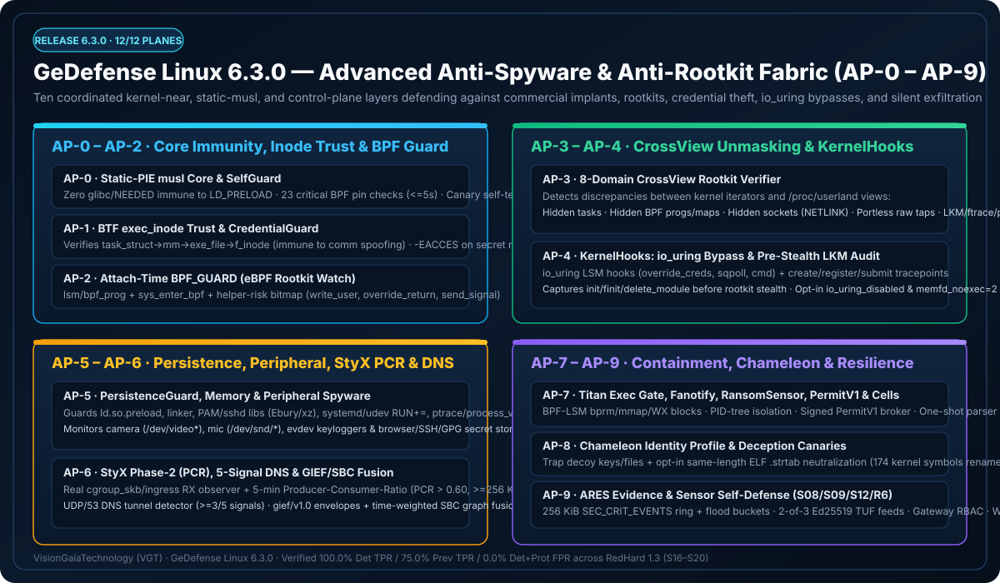
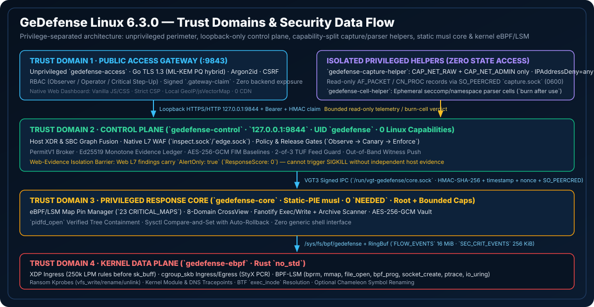

<div align="center">


# VGT GeDefense Linux `6.3.0` — *GeDefense Vasili Edition*
### Локальная суверенная платформа безопасности Linux и защита от шпионского ПО — Your Entenprise System

<sub>*(Примечание: «Entenprise» — умышленная игра слов от нем. «Ente» — «утка» и талисмана Sir Quacksec 🦆)*</sub>

[](https://www.gnu.org/licenses/agpl-3.0)
[](RELEASE-NOTES.md)
[](RELEASE-NOTES.md)
[-brightgreen?style=for-the-badge)](RELEASE-NOTES.md)
[](docs/INSTALLATION.md)
[](docs/ARCHITECTURE.md)
[](docs/ARCHITECTURE.md)
[](docs/ANTISPYWARE.md)
[](docs/SECURITY-MODEL.md)
[](benchmarks/vgt-hardred-6.3.0/)
[](benchmarks/vgt-hardred-6.3.0/hardred/)
[](https://visiongaiatechnology.de)

**СЕТЕВАЯ ЗАЩИТА НА УРОВНЕ ЯДРА · ХОСТОВЫЙ XDR · АНТИШПИОНСКАЯ ЗАЩИТА `AP-0`–`AP-9` · ЗАШИФРОВАННЫЕ ДОКАЗАТЕЛЬСТВА · ОБРАТИМЫЙ ХАРДЕНИНГ · БЕЗ ОБЛАЧНОЙ ПАНЕЛИ**


<br />

🌐 **Languages / Sprachen / Языки / 语言:**  
[English](README.md) · [Deutsch](README.de.md) · **Русский** · [中文 (简体)](README.zh.md)

<br />

⬇️ **Официальные установщики и доказательства v6.3.0:**  
[**OneClick-установщик (`.run`)**](https://github.com/visiongaiatechnology/gedefense/releases/download/v6.3.0/VGT_GeDefense_V6_6.3.0_OneClick.run) · [`.sha256`](https://github.com/visiongaiatechnology/gedefense/releases/download/v6.3.0/VGT_GeDefense_V6_6.3.0_OneClick.run.sha256) · [**Desktop Tray (`.run`)**](https://github.com/visiongaiatechnology/gedefense/releases/download/v6.3.0/GeDefense-6.3.0-Desktop-OneClick.run) · [`.sha256`](https://github.com/visiongaiatechnology/gedefense/releases/download/v6.3.0/GeDefense-6.3.0-Desktop-OneClick.run.sha256) · [**Исходники (`.zip`)**](https://github.com/visiongaiatechnology/gedefense/releases/download/v6.3.0/VGT_GeDefense_V6_6.3.0_Source.zip) · [**Релиз v6.3.0**](https://github.com/visiongaiatechnology/gedefense/releases/tag/v6.3.0) · [**Бенчмарки (`6.3.0`)**](benchmarks/vgt-hardred-6.3.0/)

<br />


</div>

---

## 01 · Быстрая навигация

| Раздел | Содержание | Ссылка |
|---|---|---|
| 02 · **Краткий обзор** | Суверенная платформа безопасности Linux и статус готовности | [Обзор](#02--краткий-обзор-executive-overview) |
| 03 · **Новое в 6.3.0** | Антишпионские уровни `AP-0`–`AP-9`, защита ядра и рефакторинг | [Спецификация Anti-Spyware](docs/ANTISPYWARE.md) |
| 04 · **Основные возможности** | Сеть XDP, L7 WAF, XDR, Vault от шифровальщиков, аудит | [Возможности](#04--основные-возможности) |
| 05 · **Архитектура безопасности** | 7 уровней, 4 домена доверия и изоляция веб-сигналов | [Архитектура](docs/ARCHITECTURE.md) |
| 06 · **Результаты бенчмарков** | HardRed `1.2` (`94.95`), ARES `1.2`, Anti-Spyware `S16–S20` и HardRed `1.3` (`90.09`) | [Пакет бенчмарков](benchmarks/vgt-hardred-6.3.0/) |
| 07 · **Верификация и доказательства** | Отчёты, дашборды, CSV/SARIF/OCSF и локальные аудиты | [Верификация](#07--верификация-и-доказательства) |
| 08 · **Установка** | Требования, подписанные `.run`-установщики и откат | [Установка](docs/INSTALLATION.md) |
| 09 · **Конфигурация и эксплуатация** | `Observe`, `Canary`, `Enforce`, `Degraded` и Emergency Stop | [Конфигурация](docs/CONFIGURATION.md) |
| 10 · **Модель безопасности и ограничения** | Границы доверия, требования ядра и подтверждённые пределы `6.3.0` | [Модель безопасности](docs/SECURITY-MODEL.md) |
| 11 · **Ресурсы для разработчиков** | Полный индекс документации и экосистема GeDefense | [Руководство разработчика](docs/DEVELOPER-GUIDE.md) |
| 12 · **История релизов** | Сводная таблица версий (`6.3.0` → `1.0.0`) | [CHANGELOG.md](CHANGELOG.md) |
| 13 · **Лицензия и атрибуция** | `AGPL-3.0-only` и сторонние компоненты | [THIRD-PARTY-LICENSES.md](THIRD-PARTY-LICENSES.md) |

---

## 02 · Краткий обзор (Executive Overview)

**GeDefense Linux `6.3.0`** — это **локально-суверенная платформа безопасности Linux**, объединяющая сетевую фильтрацию eBPF/XDP на уровне ядра, нативный L7 WAF на Go, поведенческий XDR хоста, 10-уровневую защиту от шпионского ПО и руткитов (`AP-0`–`AP-9`), обратимое ужесточение `sysctl` и подписанный Ed25519 журнал криминалистических доказательств — **без облачной панели управления**.

```text
Традиционные стеки (iptables + auditd + fail2ban + WAF-прокси + облачный SIEM)
  Разрозненные демоны -> отсутствие единого состояния, ~1,8–2,5 GiB RAM, медленная реакция
  Правила как доверие -> ложные срабатывания вызывают самоблокировки
  Облачная телеметрия -> конфиденциальный контекст хоста покидает сервер

VGT GeDefense Linux 6.3.0
  Rust no_std eBPF/XDP + BPF-LSM -> отброс атак и запрещённых syscall прямо в ядре
  Static-PIE musl Core (UID 0)   -> иммунитет к LD_PRELOAD, изоляция pidfd, AES-GCM Vault
  Loopback Go Control (0 Cap)    -> XDR/SBC-корреляция, AlertOnly WAF, FIM, TUF-фиды
  Ed25519 + AES-256-GCM журнал   -> неизменяемые доказательства и откат (~70,8 MiB RSS)
```

> [!IMPORTANT]
> **Готовность к эксплуатации и квалификация целевого хоста (`6.3.0`):**  
> GeDefense Linux `6.3.0` — прошедший аудит и подтверждённый бенчмарками **Production-Candidate релиз**. Каждый выпуск сопровождается криптографической прослеживаемостью (`SHA256SUMS`, SPDX SBOM, подписанными манифестами/индексом), тестами Go/Rust, 10-этапным аудитом и воспроизводимыми прогонами HardRed `1.2` / `1.3` и ARES (`PASS`). На хосте система всегда стартует безопасно в режиме `observe` и требует проверки ядра (`lsm=...,bpf`), XDP-драйвера, systemd/IPC, Management Allowlist и прочтения [`SECURITY.md`](SECURITY.md) перед включением `enforce`.

---

## 03 · Новое в `6.3.0`

### 🛡️ Продвинутая защита от шпионского ПО и руткитов (`AP-0` – `AP-9`)

> **GeDefense Linux 6.3.0 · Главный фокус релиза:** Защита от скрытных Linux-имплантов (*Symbiote*, *OrBit*, *Ebury*, *LinkPro*, *VoidLink*, *BPFDoor*, *PUMAKIT*, *Curing* `io_uring`), руткитов ядра, кражи учётных данных, сокрытия процессов и скрытой эксфильтрации — активно во всех **12/12 координируемых уровнях**.

| Группа | Уровни защиты | Основной фокус |
|---|---|---|
| **`AP-0 – AP-2`** | `SelfGuard`, `CredentialGuard`, `BPF_GUARD` | Статический musl Core (`0 NEEDED`), контроль BPF-пинов/канареек, BTF `exec_inode` и карта рисков helper-функций |
| **`AP-3 – AP-4`** | `CrossView`, `KernelHooks` | 8-доменная сверка руткитов, LSM/tracepoints для `io_uring` и перехват загрузки модулей до сокрытия |
| **`AP-5 – AP-6`** | `PersistenceGuard`, `StyX PCR`, `DNS Detection` | Защита линкера/PAM/systemd/периферии/памяти, `cgroup_skb/ingress` PCR (`>0.60`), 5-сигнальный DNS и `GIEF/SBC` |
| **`AP-7 – AP-9`** | `Titan Exec`, `Chameleon`, `Evidence Resilience` | `Fanotify` + `RansomSensor`, `PermitV1`, `Parser Cells`, профиль Chameleon (174 символа), `S09`/`S12`/`R6`/`S08` |

<div align="center">
  
</div>

#### Краткое описание десяти уровней защиты

1. **`AP-0` — Статический musl Core и `SelfGuard`:** `gedefense-core` собран статически без glibc (`0 NEEDED`), устойчив к атакам `LD_PRELOAD`, проверяет **23 критических eBPF-пина** каждые `<= 5 с` и отправляет `XDR.SELF_TAMPER` во внешний Witness до записи в локальный журнал.
2. **`AP-1` — BTF `exec_inode` Trust и `CredentialGuard`:** Проверяет реальный бинарник в ядре (`task_struct -> mm -> exe_file -> f_inode`), защищая `/etc/shadow` и секреты жёстким `-EACCES` даже при подмене `comm`/`argv[0]`.
3. **`AP-2` — `BPF_GUARD` при загрузке программ:** Перехватывает `lsm/bpf_prog`, `sys_enter_bpf` и `check_helper_call`, выявляя опасные helper-вызовы (`bpf_probe_write_user`, `bpf_override_return`, `bpf_send_signal`).
4. **`AP-3` — 8-доменный `CrossView`-верификатор:** Сопоставляет итераторы ядра с `/proc` и юзерспейсом: скрытые процессы, BPF-программы/карты, сокеты (`NETLINK_SOCK_DIAG`), беспортовые raw-снифферы, скрытые LKM, ftrace-хуки, BPF-пины (с учётом обрезки ядром до 15 символов `BPF_OBJ_NAME_LEN`) и сверку библиотек с пакетной БД.
5. **`AP-4` — `KernelHooks` (`io_uring` и аудит LKM):** Закрывает асинхронный обход системных вызовов через `io_uring` и фиксирует загрузку модулей (`init_module`/`finit_module`/`delete_module`).
6. **`AP-5` — `PersistenceGuard` и защита периферии/памяти:** Защищает `/etc/ld.so.preload`, линкер, PAM/`sshd`, systemd-юниты/генераторы, `udev RUN+=`, память процессов (`ptrace`/`process_vm_readv` с корректным исключением легитимного root-чтения статуса `PTRACE_MODE_NOAUDIT`), микрофон, камеру и `evdev`-кейлоггеры.
7. **`AP-6` — `StyX Phase-2` (PCR), DNS-туннели и `GIEF / SBC Fusion`:** Реальный учёт RX через `cgroup_skb/ingress` (`PCR > 0.60`, `>= 256 KiB`), 5-сигнальный детектор DNS-туннелей (`>= 3` сигналов), конверты `gief/v1.0` и граф корреляции SBC.
8. **`AP-7` — `Titan Exec Gate`, `Fanotify`, `RansomSensor`, `PermitV1` и `Parser Cells`:** Сканирование при записи/запуске, блокировка `WX`-памяти, изоляция деревьев процессов через `pidfd` (без остановки пулов `php-fpm`/`nginx`), подписанные исключения `PermitV1` и одноразовые песочницы парсеров.
9. **`AP-8` — Режим `Chameleon` и приманки-канарейки:** Декой-ловушки плюс опциональный подписанный профиль переименования **174 eBPF-символов в ядре** (`bpftool` не видит строк `gedefense`/`styx`/`titan`), сохраняя обратимость для администратора.
10. **`AP-9` — Самозащита `ARES`:** Выделенное высокоприоритетное кольцо **`SEC_CRIT_EVENTS` (256 KiB)** против Log-DoS (`S12` с учётом SMP clock-skew), 2-из-3 Ed25519 TUF-подписи фидов (`S09`), серверный RBAC шлюза (`R6`) и приоритетный пуш Witness (`S08`/`S15`).

> 📘 **Полная техническая спецификация (`AP-0`–`AP-9`):** [**`docs/ANTISPYWARE.md`**](docs/ANTISPYWARE.md)

### Прочие улучшения `6.3.0`
- **5-волновой рефакторинг архитектуры:** Модульная структура Go (`control/`, `gateway/`), Web-UI, Rust Core/eBPF и 10-этапный аудит безопасности ([`docs/REFACTORING-V6.3.0.md`](docs/REFACTORING-V6.3.0.md)).
- **Пост-релизные исправления стабильности:** Изоляция пулов `php-fpm`/`nginx`/`httpd`, допуск SMP-рассинхронизации часов в `sec_crit`, динамическое исключение локальных адресов в `StyX` + защита от спуфинга `ksoftirqd`, 15-символьное сравнение BPF-имён в `cross_view` и фильтрация легитимных root-`NOAUDIT` чтений procfs.
- **Прирост производительности:** **`648.8 HTTP RPS`** (`20.59 ms` p95) при **`70.8 MiB` RSS** и **`7.1%` CPU** ([`docs/PERFORMANCE.md`](docs/PERFORMANCE.md)).

---

## 04 · Основные возможности

| Уровень | Возможности | Справка |
|---|---|---|
| **Сетевая защита (eBPF/XDP)** | Сброс трафика до `sk_buff` (250k LPM-правил IPv4/IPv6), защита от флуда/сканирования портов, приоритет Management Allowlist, `VERIFY_EMPTY` | [`docs/ARCHITECTURE.md`](docs/ARCHITECTURE.md) |
| **Нативный L7 WAF и модули A–E** | Беззависимый Go WAF (L7 HTTP/Raw-Body), анализ экспозиции сервисов, защита воркеров от краш-штормов, изолированный `capture-helper`, LPE-блокер | [`docs/ARCHITECTURE.md`](docs/ARCHITECTURE.md) |
| **Host XDR и Anti-Spyware** | 10 уровней (`AP-0`–`AP-9`), `CrossView` (8 доменов), перехват `io_uring`, `StyX` PCR, 5-сигнальный DNS, корреляция `GIEF/SBC` | [`docs/ANTISPYWARE.md`](docs/ANTISPYWARE.md) |
| **Ransomware и Quarantine Vault** | Поведенческий сенсор энтропии/переименований, `FAN_OPEN_EXEC_PERM` + сканер архивов до глубины 8, `MALWARE_DENIED_INODES`, AES-256-GCM Vault | [`docs/SECURITY-MODEL.md`](docs/SECURITY-MODEL.md) |
| **Крипто-доказательства и харденинг** | Журнал на Ed25519, FIM на AES-GCM + `ChronosScanner`, `sysctl` compare-and-set (`astraeaos-cis-l1`) с автооткатом, Witness | [`docs/CONFIGURATION.md`](docs/CONFIGURATION.md) |

---

## 05 · Архитектура безопасности

<div align="center">
  
</div>

### Ключевые инварианты архитектуры
- **Разделение доменов доверия (`4` домена, `7` уровней):** Непривилегированный HTTPS-шлюз (`:9843`) → loopback Control Plane без Linux capabilities (`:9844`, `UID gedefense`) + изолированные хелперы (`capture-helper`, `cell-helper`) → Static-PIE musl Core (`UID 0`) → ядро Rust `no_std`.
- **Барьер изоляции веб-сигналов:** Срабатывания L7 WAF всегда имеют `AlertOnly: true` (`ResponseScore: 0`) — веб-правило не может самостоятельно запустить `SIGKILL`/`XDR_KILL_TREE` без независимого подтверждения со стороны ядра или хоста.
- **Universal Linux и AstraeaOS:** Работает на дистрибутивах с APT, DNF/YUM, pacman и Zypper, а в AstraeaOS выступает единственным авторитетом безопасности.

> 📘 **Документация по архитектуре:** [`docs/ARCHITECTURE.md`](docs/ARCHITECTURE.md) · [`ARCHITECTURE.md` (полная спецификация)](ARCHITECTURE.md)

---

## 06 · Результаты бенчмарков (`VGT HardRed` и `REDHARD ARES`)

> [!NOTE]
> **Методология и атрибуция:**  
> Все замеры выполнены с помощью открытого фреймворка **[VGT HardRed (`RedHard`)](https://github.com/visiongaiatechnology/redhard)** на изолированных по снэпшотам ВМ **Ubuntu 24.04 (Linux HWE 7.0, 4 vCPU, 4 GiB RAM, NGINX + PHP 8.3-FPM)**. **HardRed и ARES — это собственные воспроизводимые инженерные бенчмарки VGT**, а **не независимая сторонняя сертификация**.

### A. `HardRed 1.2` и `1.3` — Стандартный бенчмарк безопасности

| Набор тестов | Версия | Итоговый балл | Ось 1: Эффективность | Ось 2: FP-устойчивость | Ось 3: Латентность | Ось 4: Нагрузка | Гейт |
|---|---|---:|---:|---:|---:|---:|---|
| **HardRed 1.2** *(Базовый S01–S15)* | GeDefense `6.2.1` | `94.73` | `95.88` | `100.00` | `92.20` | `87.63` | **`PASS`** |
| **HardRed 1.2** *(Базовый S01–S15)* | **GeDefense `6.3.0`** | **`94.95`** | **`96.73`** | **`100.00`** | `88.87` | **`91.00`** | **`PASS`** |
| **HardRed 1.3** *(+ `S16–S20` и калибровка часов)* | **GeDefense `6.3.0` (`03j`)** | **`90.09`** | `90.06` | `85.71` *(0% Prot-FP)* | **`89.90`** | **`96.27`** | **`PASS`** |

<details>
<summary><strong>Полное сравнение 7 систем (HardRed 1.3 · Все домены + Anti-Spyware S16–S20)</strong></summary>

| Место | Система безопасности | Итог | Покрытие Scope | In-Scope Eff. | Эффективность | FP-устойчивость | Латентность | Нагрузка | Гейт |
|---:|---|---:|---:|---:|---:|---:|---:|---:|---|
| 1 | **GeDefense Linux 6.3.0 (`03j`)** | **90.09** | 100.0% | 90.06 | 90.06 | 85.71 | 89.90 | 96.27 | **`PASS`** |
| 2 | **OSS Best-of-Breed + SafeLine WAF** | **56.41** | 90.9% | 55.02 | 55.02 | 100.00 | 36.39 | 29.17 | `PASS` |
| 3 | **Chaitin SafeLine WAF CE 9.4.7** | **50.41** | 45.5% | 56.79 | 35.78 | 100.00 | 27.69 | 58.50 | `PASS` |
| 4 | **OSS Best-of-Breed** (`ModSec+Suricata+Tetragon+ClamAV`) | **47.87** | 90.9% | 67.98 | 67.98 | 42.86 | 38.40 | 6.83 | `FAIL` |
| 5 | **Wazuh** (`Rules+FIM+Auditd+Active Response`) | **47.72** | 81.8% | 35.90 | 35.90 | 71.43 | 28.28 | 77.47 | `CONDITIONAL` |
| 6 | **CrowdSec** (`Max Collections+Bouncers+AppSec`) | **24.73** | 36.4% | 51.66 | 31.77 | 0.00 | 18.53 | 44.88 | `FAIL` |
| Ref | **Baseline** (`Чистый Ubuntu HWE 7.0`) | **46.01** | 100.0% | 17.20 | 17.20 | 100.00 | 16.37 | 100.00 | `CONDITIONAL` |

</details>

### B. `ARES 1.2` и `1.3` — Адаптивная оценка устойчивости к атакам

| Столп оценки | GeDefense `6.2.1` (`ARES 1.2`) | GeDefense `6.3.0` (`ARES 1.2`) | GeDefense `6.3.0` (`ARES 1.3 · S01–S20`) |
|---|---:|---:|---:|
| **Design Resilience** (`R1`–`R12`) | `78.40` | **`86.90`** | **`86.90`** |
| **Runtime Resilience** | `96.68` | **`96.68`** | **`96.52`** |
| **Adaptive Adversarial Resilience** | `93.46` | **`93.46`** | **`87.70`** |
| **Самозащита** (`R5`, `R6`, `R7`) | `73.12` | **`90.00`** | **`90.00`** |
| **Прерванные цепочки / Pre-Kill Damage / FP** | `36/36` · `11.1%` · `0` | `36/36` · `11.1%` · `0` | **`54/54` · `11.6%` · `0`** (`264/267` цитат) |

### C. Кампании `HardRed 1.3` / `ARES` Anti-Spyware (`S16` – `S20`)

| Система | Балл домена | Det TPR | Prev TPR | Det / Prot FPR | Медиана TTFA (мс) | `S16` (eBPF/LKM) | `S17` (`io_uring`) | `S18` (Cred/Mem) | `S19` (CrossView) | `S20` (Self-Integrity) |
|---|---:|---:|---:|---:|---:|---|---|---|---|---|
| **GeDefense Linux 6.3.0 (`03j`)** | **84.8** | **100.0%** | **75.0%** | **0.0% / 0.0%** | **1010.9** | `DETECTED_ONLY` | `DETECTED_ONLY` | **`PREVENTED`** | **`PREVENTED`** | **`PREVENTED`** |
| **Wazuh HIDS/SIEM** | 44.2 | 80.0% | 0.0% | 0.0% / 0.0% | 613.3 | `DETECTED_ONLY` | `DETECTED_ONLY` | `DETECTED_ONLY` | `DETECTED_ONLY` | `NO_DETECTION` |
| **OSS + SafeLine WAF** | 32.5 | 40.0% | 0.0% | 0.0% / 0.0% | 408.0 | `NO_DETECTION` | `NO_DETECTION` | `DETECTED_ONLY` | `DETECTED_ONLY` | `NO_DETECTION` |
| **OSS Best-of-Breed** | 32.5 | 40.0% | 0.0% | 0.0% / 0.0% | 421.9 | `NO_DETECTION` | `NO_DETECTION` | `DETECTED_ONLY` | `DETECTED_ONLY` | `NO_DETECTION` |
| **Chaitin SafeLine WAF** | 7.5 | 0.0% | 0.0% | 0.0% / 0.0% | — | `NOT_IN_SCOPE` | `NOT_IN_SCOPE` | `NOT_IN_SCOPE` | `NOT_IN_SCOPE` | `NO_DETECTION` |
| **CrowdSec IPS/AppSec** | 7.5 | 0.0% | 0.0% | 0.0% / 0.0% | — | `NOT_IN_SCOPE` | `NOT_IN_SCOPE` | `NOT_IN_SCOPE` | `NOT_IN_SCOPE` | `NO_DETECTION` |
| **Baseline (без защиты)** | 7.5 | 0.0% | 0.0% | 0.0% / 0.0% | — | `NO_DETECTION` | `NO_DETECTION` | `NO_DETECTION` | `NO_DETECTION` | `NO_DETECTION` |

---

## 07 · Верификация и доказательства

- 📁 **Полный архив доказательств `6.3.0`:** [`benchmarks/vgt-hardred-6.3.0/`](benchmarks/vgt-hardred-6.3.0/)
  - [`hardred/`](benchmarks/vgt-hardred-6.3.0/hardred/) · [`ares/`](benchmarks/vgt-hardred-6.3.0/ares/) · [`antispyware/`](benchmarks/vgt-hardred-6.3.0/antispyware/) · [`reports/`](benchmarks/vgt-hardred-6.3.0/reports/) · [`raw-evidence/`](benchmarks/vgt-hardred-6.3.0/raw-evidence/)

```bash
make test           # Тесты Go, go vet, проверка синтаксиса JS и 10-этапный аудит
make test-race      # Проверка на гонки (control + gateway)
make fuzz-smoke     # 24 фаззинг-цели безопасности
make rust           # Нативные тесты Rust + сборки static-PIE musl и eBPF
bash scripts/validate.sh
```

---

## 08 · Установка

**Требования:** Linux `x86_64`, `systemd`, `apt`/`dnf`/`pacman`/`zypper`, `libargon2.so.1`, ядро с eBPF/XDP (`lsm=...,bpf` для полного BPF-LSM).

```bash
wget https://github.com/visiongaiatechnology/gedefense/releases/download/v6.3.0/VGT_GeDefense_V6_6.3.0_OneClick.run
wget https://github.com/visiongaiatechnology/gedefense/releases/download/v6.3.0/VGT_GeDefense_V6_6.3.0_OneClick.run.sha256
sha256sum --check VGT_GeDefense_V6_6.3.0_OneClick.run.sha256
chmod 0700 VGT_GeDefense_V6_6.3.0_OneClick.run
sudo ./VGT_GeDefense_V6_6.3.0_OneClick.run
```

> 📘 **Подробная установка, Desktop Tray и откат:** [`docs/INSTALLATION.md`](docs/INSTALLATION.md)

---

## 09 · Конфигурация и эксплуатация

GeDefense всегда запускается в режиме **`observe`** и управляет переходом через явные этапы (`observe → canary → enforce`), синхронизированный Management Allowlist и обратимые транзакции:

| Режим | Сеть | Реакция на хосте | Условие перехода |
|---|---|---|---|
| **Observe** | XDP активен, список блокировок пуст (`VERIFY_EMPTY`) | Только телеметрия | Подтверждённый Core IPC + подписанная политика |
| **Canary** | Наблюдение за сетью | `SIGSTOP` по доказательствам (`AlertOnly` для веб) | Проверенная политика + стабильный XDR |
| **Enforce** | Подписанные LPM-блокировки XDP | `SIGKILL` через `pidfd` / Vault | Непустой, синхронизированный Management Allowlist |
| **Degraded** | Отказоустойчивый режим | Активные реакции приостановлены | Требуется видимое восстановление оператором |

> 📘 **Команды переходов, Emergency Stop и профиль `EDR/Hardened Max`:** [`docs/CONFIGURATION.md`](docs/CONFIGURATION.md)

---

## 10 · Модель безопасности и ограничения

- **Ключи и доверие:** Приватный ключ подписи релизов хранится строго офлайн вне репозитория (`RELEASE-KEYS.md`); ключи времени исполнения имеют права `0600`.
- **Зависимость от `bpf` LSM:** Принудительная блокировка в ядре (`Titan Exec Gate`, `CredentialGuard`, `BPF_GUARD`) требует наличия `bpf` в `/sys/kernel/security/lsm`; при отсутствии возвращается честный статус `inactive`.
- **Подтверждённые ограничения `6.3.0`:** Без кластерной mesh-синхронизации, без QUIC-оффлоадинга и TLS-дешифрования, не заменяет защиту от объёмного DDoS на уровне провайдера, не даёт гарантий при уже скомпрометированном root-ядре. `AS-S16` и `AS-S17` по умолчанию работают как `DETECTED_ONLY` (жёсткое отключение `io_uring` — опционально через `kernel.io_uring_disabled`), `Feed Auto-Enforce`/`Emergency Lockdown`/`Witness`/`Chameleon` остаются опциональными, а мост WordPress находится в статусе alpha ([`SECURITY.md`](SECURITY.md)).

> 📘 **Подробная модель безопасности и ограничения:** [`docs/SECURITY-MODEL.md`](docs/SECURITY-MODEL.md) · [`SECURITY.md`](SECURITY.md)

---

## 11 · Ресурсы для разработчиков и исследователей

| Ресурс | Назначение | Ссылка |
|---|---|---|
| **Архитектура** | Схема доменов доверия и полная спецификация (`4 400+` строк) | [`docs/ARCHITECTURE.md`](docs/ARCHITECTURE.md) · [`ARCHITECTURE.md`](ARCHITECTURE.md) |
| **Anti-Spyware** | Подробное описание `AP-0`–`AP-9` и API счётчики | [`docs/ANTISPYWARE.md`](docs/ANTISPYWARE.md) |
| **Безопасность и криптография** | Инварианты, криптопрофиль и ограничения `6.3.0` | [`docs/SECURITY-MODEL.md`](docs/SECURITY-MODEL.md) · [`CRYPTOGRAPHY.md`](CRYPTOGRAPHY.md) |
| **API и эксплуатация** | Роли RBAC, маршруты `/api/v1/*` и настройка | [`docs/API-REFERENCE.md`](docs/API-REFERENCE.md) · [`docs/CONFIGURATION.md`](docs/CONFIGURATION.md) |
| **Производительность и диагностика** | Метрики накладных расходов и устранение неполадок | [`docs/PERFORMANCE.md`](docs/PERFORMANCE.md) · [`docs/TROUBLESHOOTING.md`](docs/TROUBLESHOOTING.md) |
| **Разработка и сборка** | Тесты, фаззинг, упаковка релизов и бета-план | [`docs/DEVELOPER-GUIDE.md`](docs/DEVELOPER-GUIDE.md) · [`BETA-TEST-PLAN.md`](BETA-TEST-PLAN.md) |

### Экосистема GeDefense

| Платформа | Фокус | Репозиторий |
|---|---|---|
| **GeDefense Linux** *(этот репозиторий)* | Ядро eBPF/XDP, L7 WAF, Host XDR, Anti-Spyware `AP-0`–`AP-9` | [`visiongaiatechnology/gedefense`](https://github.com/visiongaiatechnology/gedefense) |
| **GeDefense Windows** | Локальная консоль Windows 11, Defender/ASR/WFP и MHX EDR | [`visiongaiatechnology/gedefensewin`](https://github.com/visiongaiatechnology/gedefensewin) |
| **GeDefense Android** | Локальный VPN, телеметрия конечных точек и XDR/EDR | [`visiongaiatechnology/gedefenseandroid`](https://github.com/visiongaiatechnology/gedefenseandroid) |
| **GeDefense Android TV** | Консоль безопасности для Android TV / Google TV и Kinetic-Lite | [`visiongaiatechnology/gedefense_androidtv`](https://github.com/visiongaiatechnology/gedefense_androidtv) |
| **GeDefense WordPress** | Защитный пакет WordPress (ZEUS WAF, AEGIS, TRINITY XDR, HADES) | [`visiongaiatechnology/gedefensewp`](https://github.com/visiongaiatechnology/gedefensewp) |

---

## 12 · История релизов

| Релиз | Дата | Основные изменения | Подробнее |
|---|---|---|---|
| **`v6.3.0`** *(Текущий)* | `2026-11-26` | Уровни `AP-0`–`AP-9`, 5-волновой рефакторинг, фиксы ядра/пулов, HardRed `1.2` (`94.95`) и `1.3` (`90.09 · PASS`) + ARES `1.3` | [`CHANGELOG.md`](CHANGELOG.md) · [`RELEASE-NOTES.md`](RELEASE-NOTES.md) |
| `v6.2.1` | `2026-11-23` | Блокировка `MALWARE_DENIED_INODES`, поведенческий XDR ядра, изоляция пулов (`94.73 · PASS`) | [`docs/V6.2.1-RELEASE.md`](docs/V6.2.1-RELEASE.md) |
| `v6.2.0` | `2026-11-22` | `FAN_CLOSE_WRITE` Vault, Titan Exec `untrusted`, eBPF RansomSensor (`86.16 · PASS`) | [`docs/V6.2.0-RELEASE.md`](docs/V6.2.0-RELEASE.md) |
| `v6.1.0` – `v6.1.2` | `2026-11-18..20` | Модули A–E, изолированный `capture-helper`, поддержка BTF ядра 7.3 | [`docs/V6.1.2-HOTFIX.md`](docs/V6.1.2-HOTFIX.md) |
| `v6.0.0` – `v6.0.3` | `2026-11-15..17` | 5-компонентная суверенная архитектура (StyX, Titan, Parser Cells, Witness, Lockdown) | [`CHANGELOG.md`](CHANGELOG.md) |

---

## 13 · Лицензия и атрибуция

GeDefense Linux распространяется под лицензией **`AGPL-3.0-only`** ([`LICENSE`](LICENSE)). Сторонние компоненты и публичные наборы данных сохраняют свои отдельные лицензии (подробности в [`THIRD-PARTY-LICENSES.md`](THIRD-PARTY-LICENSES.md)):

| Компонент / данные | Источник | Лицензия |
|---|---|---|
| **jsVectorMap 1.7.0** (локальная карта SVG) | [themustafaomar/jsvectormap](https://github.com/themustafaomar/jsvectormap) | **MIT** © 2020 Mustafa Omar |
| **IP-to-Country / IP-to-ASN** (`geoip.csv` офлайн) | [iplocate/ip-address-databases](https://github.com/iplocate/ip-address-databases) | **CC BY-SA 4.0** (преобразовано VGT для GeDefense; распространяется на условиях CC BY-SA 4.0) |
| **DB-IP Lite** (данные GeoIP для апдейтера) | [db-ip.com](https://db-ip.com/) | **CC BY 4.0** (требуется указание авторства) |
| **Origin-ASN data** (источник для апдейтера) | [sapics/ip-location-db](https://github.com/sapics/ip-location-db) | **PDDL** |
| **Qt 6** (опциональный системный трей, динамическая линковка) | [qt.io](https://www.qt.io/) | **LGPL-3.0** / коммерческая лицензия Qt |

*Во время работы дашборд не использует внешние CDN или облачные запросы.*
