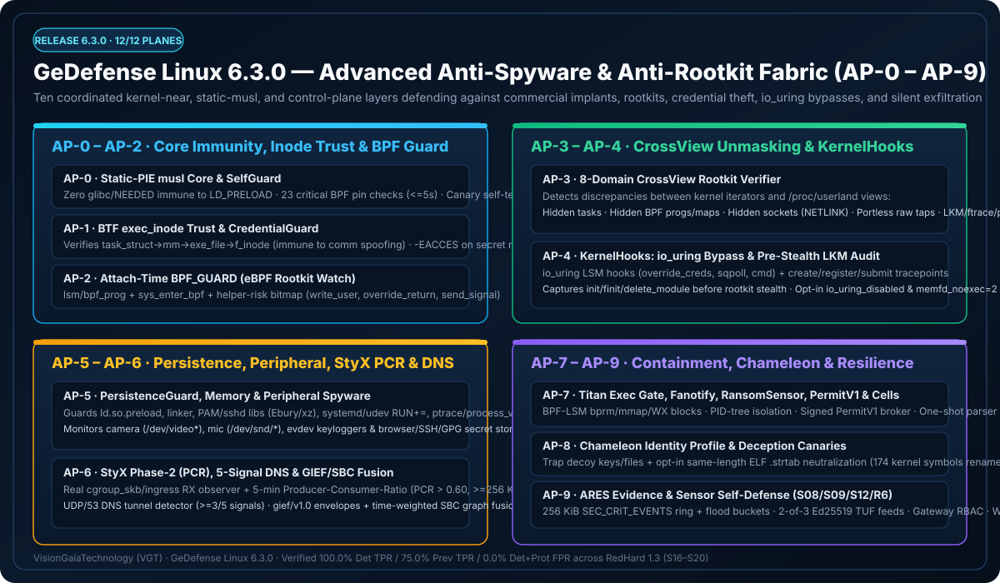
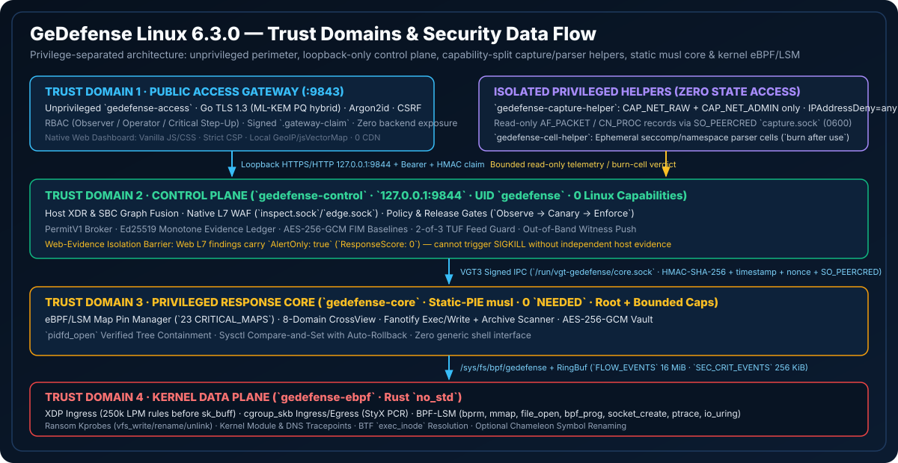

<div align="center">


# VGT GeDefense Linux `6.3.0` — *GeDefense Vasili Edition*
### 本地主权型 Linux 安全织网与反间谍防御系统 — Your Entenprise System

<sub>*(注：“Entenprise” 源自德语 “Ente” [鸭子]，致敬 VGT 吉祥物 Sir Quacksec 🦆)*</sub>

[](https://www.gnu.org/licenses/agpl-3.0)
[](RELEASE-NOTES.md)
[](RELEASE-NOTES.md)
[](BETA-TEST-PLAN.md)
[](docs/INSTALLATION.md)
[](docs/ARCHITECTURE.md)
[](docs/ARCHITECTURE.md)
[](docs/ANTISPYWARE.md)
[](docs/SECURITY-MODEL.md)
[](benchmarks/vgt-hardred-6.3.0/)
[](benchmarks/vgt-hardred-6.3.0/hardred/)
[](https://visiongaiatechnology.de)

**内核近源网络防御 · 主机 XDR · `AP-0`–`AP-9` 反间谍防御 · 加密证据链 · 可逆加固 · 零云端控制面**


<br />

🌐 **Languages / Sprachen / Языки / 语言:**  
[English](README.md) · [Deutsch](README.de.md) · [Русский](README.ru.md) · **中文 (简体)**

<br />

⬇️ **官方 v6.3.0 安装程序与证据归档：**  
[**OneClick 安装程序 (`.run`)**](https://github.com/visiongaiatechnology/gedefense/releases/download/v6.3.0/VGT_GeDefense_V6_6.3.0_OneClick.run) · [`.sha256`](https://github.com/visiongaiatechnology/gedefense/releases/download/v6.3.0/VGT_GeDefense_V6_6.3.0_OneClick.run.sha256) · [**Desktop Tray (`.run`)**](https://github.com/visiongaiatechnology/gedefense/releases/download/v6.3.0/GeDefense-6.3.0-Desktop-OneClick.run) · [`.sha256`](https://github.com/visiongaiatechnology/gedefense/releases/download/v6.3.0/GeDefense-6.3.0-Desktop-OneClick.run.sha256) · [**源码归档 (`.zip`)**](https://github.com/visiongaiatechnology/gedefense/releases/download/v6.3.0/VGT_GeDefense_V6_6.3.0_Source.zip) · [**v6.3.0 发布页**](https://github.com/visiongaiatechnology/gedefense/releases/tag/v6.3.0) · [**基准测试结果 (`6.3.0`)**](benchmarks/vgt-hardred-6.3.0/)

<br />


</div>

---

## 01 · 快速导航

| 章节 | 内容概览 | 文档链接 |
|---|---|---|
| 02 · **执行摘要** | 本地主权 Linux 安全织网与生产就绪状态 | [总览](#02--执行摘要-executive-overview) |
| 03 · **6.3.0 核心更新** | `AP-0`–`AP-9` 反间谍防御、内核防护、重构与性能提升 | [反间谍技术规范](docs/ANTISPYWARE.md) |
| 04 · **核心能力** | XDP 网络、L7 WAF、主机 XDR、勒索隔离库、证据链 | [核心能力](#04--核心能力) |
| 05 · **安全架构** | 7 层架构、4 信任域隔离、数据流与 Web 证据屏障 | [架构概览](docs/ARCHITECTURE.md) |
| 06 · **基准测试结果** | HardRed `1.2` (`94.95`)、ARES `1.2`、反间谍 `S16–S20` 与 HardRed `1.3` (`90.09`) | [基准测试数据包](benchmarks/vgt-hardred-6.3.0/) |
| 07 · **验证与原始证据** | 测试报告、交互式面板、CSV/SARIF/OCSF 与本地安全审计 | [验证指南](#07--验证与原始证据) |
| 08 · **安装指南** | 环境要求、签名 `.run` 安装包校验与版本回滚 | [安装文档](docs/INSTALLATION.md) |
| 09 · **配置与运维** | `Observe`、`Canary`、`Enforce`、`Degraded` 与紧急急停 | [配置手册](docs/CONFIGURATION.md) |
| 10 · **安全模型与边界** | 信任假设、内核前置要求与经验证的 `6.3.0` 限制 | [安全模型](docs/SECURITY-MODEL.md) |
| 11 · **开发与研究资源** | 完整文档索引与 GeDefense 跨平台生态 | [开发者指南](docs/DEVELOPER-GUIDE.md) |
| 12 · **版本历史** | 精简版本时间线 (`6.3.0` → `1.0.0`) | [CHANGELOG.md](CHANGELOG.md) |
| 13 · **开源许可与署名** | `AGPL-3.0-only` 与第三方组件及数据集声明 | [THIRD-PARTY-LICENSES.md](THIRD-PARTY-LICENSES.md) |

---

## 02 · 执行摘要 (Executive Overview)

**GeDefense Linux `6.3.0`** 是一套**本地主权优先的 Linux 安全织网系统**，将内核级 eBPF/XDP 网络过滤、原生 Go 七层 WAF 检测、主机行为 XDR、十层反间谍与反 Rootkit 防护 (`AP-0`–`AP-9`)、可逆 Compare-and-Set 内核参数加固以及 Ed25519 签名取证账本融为一体——**完全不依赖任何云端控制平面**。

```text
传统拼装式安全栈（iptables + auditd + fail2ban + 反向代理 WAF + 云 SIEM）
  组件彼此孤立   -> 状态割裂，内存占用 ~1.8–2.5 GiB，响应链条冗长
  配置即信任     -> 误报规则直接导致业务锁死
  云端遥测       -> 主机敏感上下文与凭据外流

VGT GeDefense Linux 6.3.0
  Rust no_std eBPF/XDP + BPF-LSM  -> 在内核态直接丢弃恶意流量并拦截越权系统调用
  Static-PIE musl Core (UID 0)    -> 免疫 LD_PRELOAD，pidfd 进程树遏制，AES-GCM 隔离库
  Loopback Go 控制面 (零权限)     -> XDR/SBC 图关联、AlertOnly WAF、FIM、TUF 规则签名
  Ed25519 + AES-256-GCM 账本      -> 防篡改取证与原子级回滚（实测仅 ~70.8 MiB RSS）
```

> [!IMPORTANT]
> **公开测试版 (Public Beta) 与目标主机资格声明 (`6.3.0`)：**  
> GeDefense Linux `6.3.0` 目前仍处于活跃的 **Public Beta（公开测试）** 阶段（详见 [`BETA-TEST-PLAN.md`](BETA-TEST-PLAN.md)）。每次发布均附带可验证的构建溯源（`SHA256SUMS`、SPDX SBOM、Ed25519 签名清单与索引）、Go/Rust 自动化测试、10 阶段静态安全审计以及完整的 HardRed `1.2` / `1.3` 与 ARES 实测结果（`PASS`）。部署到目标主机时系统默认以 `observe` 安全模式启动；启用 `enforce` 前必须完成目标内核 (`lsm=...,bpf`)、网卡 XDP 模式、systemd/IPC 及管理白名单验证，并审阅 [`SECURITY.md`](SECURITY.md)。

---

## 03 · `6.3.0` 核心更新

### 🛡️ 高级反间谍与反 Rootkit 防护体系 (`AP-0` – `AP-9`)

> **GeDefense Linux 6.3.0 · 新版本亮点：** 全面对抗现代 Linux 隐蔽植入物（*Symbiote*、*OrBit*、*Ebury*、*LinkPro*、*VoidLink*、*BPFDoor*、*PUMAKIT*、*Curing* `io_uring`）、内核操纵、凭据窃取、进程隐藏与静默数据外泄——全套 **12/12 防护平面** 协同运作。

| 分组 | 防护平面 | 核心职责 |
|---|---|---|
| **`AP-0 – AP-2`** | `SelfGuard`, `CredentialGuard`, `BPF_GUARD` | Static-PIE musl 免疫 (`0 NEEDED`)、BPF Pin/Canary 监控、BTF `exec_inode` 信任与 Helper 风险位图 |
| **`AP-3 – AP-4`** | `CrossView`, `KernelHooks` | 8 域 Rootkit 视图差异核验、`io_uring` LSM/Tracepoint 与隐身前内核模块捕获 |
| **`AP-5 – AP-6`** | `PersistenceGuard`, `StyX PCR`, `DNS Detection` | 链接器/PAM/systemd/外设与内存防护、`cgroup_skb/ingress` PCR (`>0.60`)、5 信号 DNS 与 `GIEF/SBC` |
| **`AP-7 – AP-9`** | `Titan Exec`, `Chameleon`, `Evidence Resilience` | `Fanotify` + `RansomSensor`、`PermitV1`、`Parser Cells`、174 符号变色龙伪装、`S09`/`S12`/`R6`/`S08` |

<div align="center">
  
</div>

#### 十层反间谍平面简述

1. **`AP-0` — Static-PIE musl 核心与 `SelfGuard`：** 无 glibc 静态链接（零 `NEEDED` 库，免疫 `LD_PRELOAD` 注入），每 `<= 5 秒` 校验 **23 个 `CRITICAL_MAPS`** Pin 并在本地落盘前优先向外部 Witness 发送 `XDR.SELF_TAMPER`。
2. **`AP-1` — BTF `exec_inode` 信任与 `CredentialGuard`：** 基于内核 `task_struct -> mm -> exe_file -> f_inode` 真实可执行文件身份决策，无视 `comm`/`argv[0]` 伪造，以 `-EACCES` 阻止未授权进程读取 `/etc/shadow` 等敏感凭据。
3. **`AP-2` — 加载时 `BPF_GUARD`：** 挂钩 `lsm/bpf_prog`、`sys_enter_bpf` 与 `check_helper_call`，识别高危内核 Helper（`bpf_probe_write_user`、`bpf_override_return`、`bpf_send_signal`）。
4. **`AP-3` — 8 域 `CrossView` 核验器：** 对比内核迭代器与 `/proc`/用户态视图，揭露隐藏进程、隐藏 eBPF 程序/Map、隐藏套接字 (`NETLINK_SOCK_DIAG`)、无端口 Raw 抓包、隐藏 LKM、Ftrace 钩子、BPF Pin 篡改（适配内核 15 字符 `BPF_OBJ_NAME_LEN` 截断）及与系统包库不一致的共享库映射。
5. **`AP-4` — `KernelHooks`（`io_uring` 与 LKM 审计）：** 覆盖 `io_uring` 异步系统调用绕过（LSM 与 Tracepoints）以及内核模块隐藏前的加载捕获（`init_module`/`finit_module`/`delete_module`）。
6. **`AP-5` — `PersistenceGuard` 与外设/内存防护：** 保护 `/etc/ld.so.preload`、动态链接器、PAM/`sshd` 依赖库、systemd 单元、udev 规则及 `ptrace`/`process_vm_readv` 内存窃取（精准区分合法 `PTRACE_MODE_NOAUDIT` 系统状态检查与恶意抓包），同时监测摄像头、麦克风与 `evdev` 键盘记录。
7. **`AP-6` — `StyX Phase-2` (PCR)、DNS 隧道与 `GIEF / SBC Fusion`：** 借助 `cgroup_skb/ingress` 获取真实 RX 计数（`PCR > 0.60` 且 `>= 256 KiB`），5 信号 DNS 隧道分析（`>= 3` 信号同时命中才告警）及 `gief/v1.0` 图关联引擎。
8. **`AP-7` — `Titan Exec Gate`、`Fanotify`、`RansomSensor`、`PermitV1` 与 `Parser Cells`：** 执行前/写入后异步查杀、内核 `WX` 内存拦截、`pidfd` 进程树遏制（保护 `php-fpm`/`nginx` 工作池不被误杀）、签名例外代理 `PermitV1` 与一次性隔离解析沙盒。
9. **`AP-8` — `Chameleon` 变色龙身份模式与诱饵 Canary：** 结合诱饵文件陷阱与可选签名配置，在加载时等长重写 **174 个内核 eBPF 符号**（`bpftool` 看不到任何 `gedefense`/`styx`/`titan` 字样），防止自动化杀手工具定位安全代理。
10. **`AP-9` — `ARES` 抗打击与证据自保护：** 独立 **256 KiB `SEC_CRIT_EVENTS`** 高优先级环形缓冲区确保证据在日志洪泛下零丢失（`S12` 兼容多核 SMP 时钟偏差）、2-of-3 Ed25519 TUF 规则防投毒（`S09`）、网关 RBAC 分级授权（`R6`）及 Witness 优先推送（`S08`/`S15`）。

> 📘 **完整反间谍技术规范 (`AP-0`–`AP-9`、API 指标与 `S16–S20` 映射)：** [**`docs/ANTISPYWARE.md`**](docs/ANTISPYWARE.md)

### `6.3.0` 其他工程升级
- **五波次结构化重构：** 对 Go 控制/网关、Web UI、Rust Core/eBPF 与 10 阶段静态审计进行模块拆分与规范化（[`docs/REFACTORING-V6.3.0.md`](docs/REFACTORING-V6.3.0.md)）。
- **发布后稳定性加固：** 面板 PHP-FPM 工作池精准隔离、`sec_crit` SMP 时钟容错、`StyX` 动态本机接口过滤与 `ksoftirqd` 防伪造、`cross_view` 15 字符 BPF 名称匹配及 Root `NOAUDIT` 状态读取零误报优化。
- **实测性能提升：** 全量防护开启下 HTTP 吞吐达到 **`648.8 RPS`**（p95 延迟 `20.59 ms`），安全进程常驻内存仅 **`70.8 MiB` RSS**，CPU 仅 **`7.1%`**（[`docs/PERFORMANCE.md`](docs/PERFORMANCE.md)）。

---

## 04 · 核心能力

| 防护层面 | 核心能力 | 参考文档 |
|---|---|---|
| **网络防御 (eBPF/XDP)** | `sk_buff` 分配前线速丢包（25 万条 LPM 规则，IPv4/IPv6）、洪泛/端口扫描自动遏制、管理白名单优先、`VERIFY_EMPTY` | [`docs/ARCHITECTURE.md`](docs/ARCHITECTURE.md) |
| **原生 L7 WAF 与 A–E 模块** | 零外部依赖 Go HTTP/Raw-Body WAF、ELF 暴露面扫描、工作进程崩溃风暴防护、独立 `capture-helper`、LPE Socket 拦截 | [`docs/ARCHITECTURE.md`](docs/ARCHITECTURE.md) |
| **主机 XDR 与反间谍** | `AP-0`–`AP-9` 十层协同、8 域 `CrossView` 核验、`io_uring` 审计、`StyX` 出站 PCR、5 信号 DNS 隧道、`GIEF/SBC` 关联 | [`docs/ANTISPYWARE.md`](docs/ANTISPYWARE.md) |
| **勒索与恶意样本隔离库** | 内核高熵写入与重命名风暴遏制、`FAN_OPEN_EXEC_PERM` + 深层归档扫描、`MALWARE_DENIED_INODES` 与 AES-256-GCM 隔离库 | [`docs/SECURITY-MODEL.md`](docs/SECURITY-MODEL.md) |
| **取证账本与可逆加固** | Ed25519 单调防篡改账本、AES-GCM FIM 与 `ChronosScanner`、原子级 Compare-and-Set `sysctl` 加固与自动回滚 | [`docs/CONFIGURATION.md`](docs/CONFIGURATION.md) |

---

## 05 · 安全架构

<div align="center">
  
</div>

### 核心架构不变量
- **四信任域七层隔离：** 非特权 HTTPS 网关（`:9843`）→ 仅限回环零特权控制面（`:9844`，`UID gedefense`）+ 隔离辅助服务（`capture-helper` 无密钥与状态访问权，一次性 `cell-helper`）→ Static-PIE musl 响应核心（`UID 0`）→ Rust `no_std` 内核数据面。
- **Web 证据隔离屏障：** 所有七层 Web 检测结果强制标记 `AlertOnly: true`（`ResponseScore: 0`），Web 规则绝不允许单独触发 `SIGKILL`/`XDR_KILL_TREE`。
- **通用 Linux 与 AstraeaOS：** 原生支持 APT、DNF/YUM、pacman 与 Zypper 发行版，并在 AstraeaOS 中担任唯一权威安全引擎。

> 📘 **架构文档：** [`docs/ARCHITECTURE.md`](docs/ARCHITECTURE.md) · [`ARCHITECTURE.md`（4,400+ 行完整规范）](ARCHITECTURE.md)

---

## 06 · 基准测试结果 (`VGT HardRed` 与 `REDHARD ARES`)

> [!NOTE]
> **评测方法与独立性声明：**  
> 以下所有数据均使用开源基准套件 **[VGT HardRed (`RedHard`)](https://github.com/visiongaiatechnology/redhard)** 在快照隔离的 **Ubuntu 24.04（Linux HWE 7.0，4 vCPU，4 GiB RAM，NGINX + PHP 8.3-FPM）** 目标虚拟机上测得。**HardRed 与 ARES 是 VGT 自研的可复现工程评估基准**，采用客观严苛的通过门禁，**并非外部第三方认证**。

### A. `HardRed 1.2` 与 `1.3` — 标准安全基准评测

| 基准套件 | 受测版本 | 综合得分 | 轴 1：防护效能 | 轴 2：误报韧性 | 轴 3：延迟 | 轴 4：开销 | 门禁结果 |
|---|---|---:|---:|---:|---:|---:|---|
| **HardRed 1.2** *(基础集 S01–S15)* | GeDefense `6.2.1` | `94.73` | `95.88` | `100.00` | `92.20` | `87.63` | **`PASS`** |
| **HardRed 1.2** *(基础集 S01–S15)* | **GeDefense `6.3.0`** | **`94.95`** | **`96.73`** | **`100.00`** | `88.87` | **`91.00`** | **`PASS`** |
| **HardRed 1.3** *(+ `S16–S20` 与管道时钟修复)* | **GeDefense `6.3.0` (`03j`)** | **`90.09`** | `90.06` | `85.71` *(0% 拦截误报)* | **`89.90`** | **`96.27`** | **`PASS`** |

<details>
<summary><strong>7 套系统全维度横向对比 (HardRed 1.3 · 全领域 + 反间谍 S16–S20)</strong></summary>

| 排名 | 安全方案 | 总分 | Scope 覆盖 | 域内效能 | 防护效能 | 误报韧性 | 延迟 | 系统开销 | 门禁 |
|---:|---|---:|---:|---:|---:|---:|---:|---:|---|
| 1 | **GeDefense Linux 6.3.0 (`03j`)** | **90.09** | 100.0% | 90.06 | 90.06 | 85.71 | 89.90 | 96.27 | **`PASS`** |
| 2 | **OSS Best-of-Breed + SafeLine WAF** | **56.41** | 90.9% | 55.02 | 55.02 | 100.00 | 36.39 | 29.17 | `PASS` |
| 3 | **长亭雷池 SafeLine WAF CE 9.4.7** | **50.41** | 45.5% | 56.79 | 35.78 | 100.00 | 27.69 | 58.50 | `PASS` |
| 4 | **OSS Best-of-Breed** (`ModSec+Suricata+Tetragon+ClamAV`) | **47.87** | 90.9% | 67.98 | 67.98 | 42.86 | 38.40 | 6.83 | `FAIL` |
| 5 | **Wazuh** (`Rules+FIM+Auditd+Active Response`) | **47.72** | 81.8% | 35.90 | 35.90 | 71.43 | 28.28 | 77.47 | `CONDITIONAL` |
| 6 | **CrowdSec** (`Max Collections+Bouncers+AppSec`) | **24.73** | 36.4% | 51.66 | 31.77 | 0.00 | 18.53 | 44.88 | `FAIL` |
| Ref | **Baseline** (`纯净 Ubuntu HWE 7.0`) | **46.01** | 100.0% | 17.20 | 17.20 | 100.00 | 16.37 | 100.00 | `CONDITIONAL` |

</details>

### B. `ARES 1.2` 与 `1.3` — 自适应对抗评估

| 评估支柱 | GeDefense `6.2.1` (`ARES 1.2`) | GeDefense `6.3.0` (`ARES 1.2`) | GeDefense `6.3.0` (`ARES 1.3 · S01–S20`) |
|---|---:|---:|---:|
| **Design Resilience** (`R1`–`R12`) | `78.40` | **`86.90`** | **`86.90`** |
| **Runtime Resilience** | `96.68` | **`96.68`** | **`96.52`** |
| **Adaptive Adversarial Resilience** | `93.46` | **`93.46`** | **`87.70`** |
| **系统自保护能力** (`R5`, `R6`, `R7`) | `73.12` | **`90.00`** | **`90.00`** |
| **阻断攻击链 / 事前损害 / 误报数** | `36/36` · `11.1%` · `0` | `36/36` · `11.1%` · `0` | **`54/54` · `11.6%` · `0`** (`264/267` 实证引用) |

### C. `HardRed 1.3` / `ARES` 反间谍专项评估 (`S16` – `S20`)

| 安全方案 | 域得分 | 检测 TPR | 阻断 TPR | 检测 / 拦截 FPR | 中位 TTFA (ms) | `S16` (eBPF/LKM) | `S17` (`io_uring`) | `S18` (Cred/Mem) | `S19` (CrossView) | `S20` (自完整性) |
|---|---:|---:|---:|---:|---:|---|---|---|---|---|
| **GeDefense Linux 6.3.0 (`03j`)** | **84.8** | **100.0%** | **75.0%** | **0.0% / 0.0%** | **1010.9** | `DETECTED_ONLY` | `DETECTED_ONLY` | **`PREVENTED`** | **`PREVENTED`** | **`PREVENTED`** |
| **Wazuh HIDS/SIEM** | 44.2 | 80.0% | 0.0% | 0.0% / 0.0% | 613.3 | `DETECTED_ONLY` | `DETECTED_ONLY` | `DETECTED_ONLY` | `DETECTED_ONLY` | `NO_DETECTION` |
| **OSS + SafeLine WAF** | 32.5 | 40.0% | 0.0% | 0.0% / 0.0% | 408.0 | `NO_DETECTION` | `NO_DETECTION` | `DETECTED_ONLY` | `DETECTED_ONLY` | `NO_DETECTION` |
| **OSS Best-of-Breed** | 32.5 | 40.0% | 0.0% | 0.0% / 0.0% | 421.9 | `NO_DETECTION` | `NO_DETECTION` | `DETECTED_ONLY` | `DETECTED_ONLY` | `NO_DETECTION` |
| **Chaitin SafeLine WAF** | 7.5 | 0.0% | 0.0% | 0.0% / 0.0% | — | `NOT_IN_SCOPE` | `NOT_IN_SCOPE` | `NOT_IN_SCOPE` | `NOT_IN_SCOPE` | `NO_DETECTION` |
| **CrowdSec IPS/AppSec** | 7.5 | 0.0% | 0.0% | 0.0% / 0.0% | — | `NOT_IN_SCOPE` | `NOT_IN_SCOPE` | `NOT_IN_SCOPE` | `NOT_IN_SCOPE` | `NO_DETECTION` |
| **Baseline (无防护)** | 7.5 | 0.0% | 0.0% | 0.0% / 0.0% | — | `NO_DETECTION` | `NO_DETECTION` | `NO_DETECTION` | `NO_DETECTION` | `NO_DETECTION` |

---

## 07 · 验证与原始证据

- 📁 **完整 `6.3.0` 评测证据包：** [`benchmarks/vgt-hardred-6.3.0/`](benchmarks/vgt-hardred-6.3.0/)
  - [`hardred/`](benchmarks/vgt-hardred-6.3.0/hardred/) · [`ares/`](benchmarks/vgt-hardred-6.3.0/ares/) · [`antispyware/`](benchmarks/vgt-hardred-6.3.0/antispyware/) · [`reports/`](benchmarks/vgt-hardred-6.3.0/reports/) · [`raw-evidence/`](benchmarks/vgt-hardred-6.3.0/raw-evidence/)

```bash
make test           # Go 单元测试、go vet、JS 语法与 10 阶段安全审计
make test-race      # Go 并发竞态检测 (control + gateway)
make fuzz-smoke     # 24 项安全模糊测试
make rust           # Rust 原生测试与 static-PIE musl + eBPF 构建
bash scripts/validate.sh
```

---

## 08 · 安装指南

**环境要求：** Linux `x86_64`、`systemd`、`apt`/`dnf`/`pacman`/`zypper`、`libargon2.so.1`，支持 eBPF/XDP 的内核（推荐启用 `lsm=...,bpf` 以开启完整 BPF-LSM 强制防护）。

```bash
wget https://github.com/visiongaiatechnology/gedefense/releases/download/v6.3.0/VGT_GeDefense_V6_6.3.0_OneClick.run
wget https://github.com/visiongaiatechnology/gedefense/releases/download/v6.3.0/VGT_GeDefense_V6_6.3.0_OneClick.run.sha256
sha256sum --check VGT_GeDefense_V6_6.3.0_OneClick.run.sha256
chmod 0700 VGT_GeDefense_V6_6.3.0_OneClick.run
sudo ./VGT_GeDefense_V6_6.3.0_OneClick.run
```

> 📘 **桌面托盘安装包、源码构建、目录布局与回滚：** [`docs/INSTALLATION.md`](docs/INSTALLATION.md)

---

## 09 · 配置与运维

GeDefense 启动后默认停留在安全的 **`observe`** 模式，并通过晋升门禁（`observe → canary → enforce`）、管理白名单同步及可逆事务管理运行状态：

| 阶段 | 网络策略 | 主机与进程动作 | 晋升条件 |
|---|---|---|---|
| **Observe** | XDP 已挂载，黑名单为空 (`VERIFY_EMPTY`) | 仅记录遥测告警 | Core IPC 已认证 + 签名 Observe 策略 |
| **Canary** | 网络保持观察 | 凭据校验后执行 `SIGSTOP`（Web 层为 `AlertOnly`） | 策略就绪 + 观察期 + XDR 健康 |
| **Enforce** | 签名 XDP LPM 拦截规则 | 代理核验 `pidfd` `SIGKILL` / 隔离库 | 非空且已同步的管理白名单 |
| **Degraded** | 故障降级 / 状态未确认 | 暂停主动拦截 | 需管理员介入并恢复正常状态 |

> 📘 **阶段切换命令、Emergency Stop 与 `EDR/Hardened Max` 配置参考：** [`docs/CONFIGURATION.md`](docs/CONFIGURATION.md)

---

## 10 · 安全模型与边界

- **密钥与托管边界：** 发布签名私钥严格离线保存于仓库之外（[`RELEASE-KEYS.md`](RELEASE-KEYS.md)）；本地运行密钥权限为 `0600`。
- **`bpf` LSM 依赖：** 完整内核执行拦截（`Titan Exec Gate`、`CredentialGuard`、`BPF_GUARD`）需内核启用 `/sys/kernel/security/lsm` 中的 `bpf`，否则如实报告 `inactive`。
- **经验证的 `6.3.0` 边界：** 不支持多节点 Swarm/Mesh 协同、不支持 QUIC 卸载与 TLS 中间人解密、不替代上游运营商级大流量 DDoS 清洗、无法保证已发生完全 root 内核沦陷后的主机完整性。`AS-S16` 与 `AS-S17` 默认处于 `DETECTED_ONLY` 模式（彻底禁用 `io_uring` 需显式启用 `kernel.io_uring_disabled`），`Feed Auto-Enforce` / `Emergency Lockdown` / `Witness` / `Chameleon` 均为显式 Opt-in，WordPress 桥接器处于 Alpha 预览状态（[`SECURITY.md`](SECURITY.md)）。

> 📘 **完整安全模型与限制说明：** [`docs/SECURITY-MODEL.md`](docs/SECURITY-MODEL.md) · [`SECURITY.md`](SECURITY.md)

---

## 11 · 开发与研究资源

| 文档资源 | 用途 | 链接 |
|---|---|---|
| **架构总览** | 信任域图示与 4,400+ 行完整技术架构 | [`docs/ARCHITECTURE.md`](docs/ARCHITECTURE.md) · [`ARCHITECTURE.md`](ARCHITECTURE.md) |
| **反间谍规范** | `AP-0`–`AP-9` 详细规格与 API 状态字段 | [`docs/ANTISPYWARE.md`](docs/ANTISPYWARE.md) |
| **安全与密码学** | 安全不变量、加密配置与 `6.3.0` 已知边界 | [`docs/SECURITY-MODEL.md`](docs/SECURITY-MODEL.md) · [`CRYPTOGRAPHY.md`](CRYPTOGRAPHY.md) |
| **API 与运维** | RBAC 角色体系、`/api/v1/*` 接口与运维配置 | [`docs/API-REFERENCE.md`](docs/API-REFERENCE.md) · [`docs/CONFIGURATION.md`](docs/CONFIGURATION.md) |
| **性能与排障** | 开销横向实测数据与常见故障排查 | [`docs/PERFORMANCE.md`](docs/PERFORMANCE.md) · [`docs/TROUBLESHOOTING.md`](docs/TROUBLESHOOTING.md) |
| **开发与测试** | 本地测试套件、模糊测试、打包与 Beta 验证计划 | [`docs/DEVELOPER-GUIDE.md`](docs/DEVELOPER-GUIDE.md) · [`BETA-TEST-PLAN.md`](BETA-TEST-PLAN.md) |

### GeDefense 全平台主权安全矩阵

| 平台 | 定位 | 仓库地址 |
|---|---|---|
| **GeDefense Linux** *(本仓库)* | 内核 eBPF/XDP、L7 WAF、主机 XDR 与 `AP-0`–`AP-9` 反间谍防御 | [`visiongaiatechnology/gedefense`](https://github.com/visiongaiatechnology/gedefense) |
| **GeDefense Windows** | Windows 11 本地主权安全台、Defender/ASR/WFP 与 MHX EDR | [`visiongaiatechnology/gedefensewin`](https://github.com/visiongaiatechnology/gedefensewin) |
| **GeDefense Android** | Android 本地 VPN 防护、终端遥测与加密取证 | [`visiongaiatechnology/gedefenseandroid`](https://github.com/visiongaiatechnology/gedefenseandroid) |
| **GeDefense Android TV** | Android TV / Google TV 环回 VPN 与 Kinetic-Lite 防护 | [`visiongaiatechnology/gedefense_androidtv`](https://github.com/visiongaiatechnology/gedefense_androidtv) |
| **GeDefense WordPress** | AGPL-3.0 WordPress 安全套件（ZEUS WAF、AEGIS、TRINITY XDR） | [`visiongaiatechnology/gedefensewp`](https://github.com/visiongaiatechnology/gedefensewp) |

---

## 12 · 版本历史

| 版本 | 日期 | 核心里程碑 | 详情 |
|---|---|---|---|
| **`v6.3.0`** *(当前版本)* | `2026-11-26` | `AP-0`–`AP-9` 反间谍防护、5 波架构重构、内核与工作池稳定性修复、HardRed `1.2` (`94.95`) / `1.3` (`90.09 · PASS`) + ARES `1.3` | [`CHANGELOG.md`](CHANGELOG.md) · [`RELEASE-NOTES.md`](RELEASE-NOTES.md) |
| `v6.2.1` | `2026-11-23` | `MALWARE_DENIED_INODES` 内核锁、内核行为 XDR、服务工作池隔离 (`94.73 · PASS`) | [`docs/V6.2.1-RELEASE.md`](docs/V6.2.1-RELEASE.md) |
| `v6.2.0` | `2026-11-22` | `FAN_CLOSE_WRITE` 隔离库、Titan `untrusted` 模式、eBPF RansomSensor (`86.16 · PASS`) | [`docs/V6.2.0-RELEASE.md`](docs/V6.2.0-RELEASE.md) |
| `v6.1.0` – `v6.1.2` | `2026-11-18..20` | 模块 A–E（暴露面/WorkerGuard/TLS/LPE/Edge）、隔离抓包助手、Kernel 7.3 BTF | [`docs/V6.1.2-HOTFIX.md`](docs/V6.1.2-HOTFIX.md) |
| `v6.0.0` – `v6.0.3` | `2026-11-15..17` | 五点主权架构（StyX、Titan、解析沙盒、Witness、紧急锁定） | [`CHANGELOG.md`](CHANGELOG.md) |

---

## 13 · 开源许可与第三方署名

GeDefense Linux 采用 **`AGPL-3.0-only`** 开源协议（见 [`LICENSE`](LICENSE)）。随附的第三方组件与公开数据集均独立适用其各自许可条款（完整声明见 [`THIRD-PARTY-LICENSES.md`](THIRD-PARTY-LICENSES.md)）：

| 组件 / 数据集 | 来源 | 许可证 |
|---|---|---|
| **jsVectorMap 1.7.0**（本地化 SVG 地图） | [themustafaomar/jsvectormap](https://github.com/themustafaomar/jsvectormap) | **MIT** © 2020 Mustafa Omar |
| **IP-to-Country / IP-to-ASN**（离线 `geoip.csv`） | [iplocate/ip-address-databases](https://github.com/iplocate/ip-address-databases) | **CC BY-SA 4.0**（由 VGT 为 GeDefense 转换并依同协议分发） |
| **DB-IP Lite**（更新器城市库数据源） | [db-ip.com](https://db-ip.com/) | **CC BY 4.0**（需保留署名） |
| **Origin-ASN 数据**（更新器源） | [sapics/ip-location-db](https://github.com/sapics/ip-location-db) | **PDDL** |
| **Qt 6**（可选桌面托盘动态链接） | [qt.io](https://www.qt.io/) | **LGPL-3.0** / Qt 商业条款 |

*控制台运行期间完全离线本地加载资源，不向任何外部 CDN 或云服务发起请求。*
