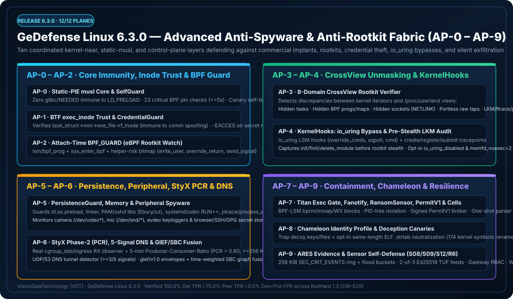

# GeDefense Linux 6.3.0 — Anti-Spyware & Anti-Rootkit Specification (`AP-0` – `AP-9`)

> **Applies to:** GeDefense Linux `6.3.0` (`gedefense-ebpf`, `gedefense-core` static-pie musl, `gedefense-control`, `gedefense-access`)  
> **Live API:** `GET /api/v1/antispyware/status` · **UI View:** Command Center → **Antispyware** (`de`, `en`, `ru`, `zh-CN`)

  

---

## 1. Threat Model & Design Scope

GeDefense Linux 6.3.0 targets stealthy Linux implants, commercial spyware frameworks (e.g., *Symbiote*, *OrBit*, *Ebury*, *LinkPro*, *VoidLink*, *BPFDoor*, *PUMAKIT*, and *Curing*-style async `io_uring` implants), kernel/userland rootkits, credential harvesters, peripheral snoopers, and telemetry-blinding attacks:

- **`LD_PRELOAD` and shared-library hijacking** targeting security daemons or SSH/PAM authentication binaries
- **`comm` / `argv[0]` masquerading** (`prctl(PR_SET_NAME)`, `[kworker]` impersonation) and unlinked `/proc/<pid>/exe (deleted)` binaries
- **Malicious eBPF rootkits** abusing `bpf_probe_write_user`, `bpf_override_return`, `bpf_send_signal`, hidden map/program IDs, or pin replacement
- **Hidden kernel objects & DKOM** across processes, sockets, portless `AF_PACKET` raw taps, ftrace hooks, and kernel modules
- **Asynchronous `io_uring` syscall evasion** bypassing classic `seccomp`/audit hooks
- **Memory & peripheral spyware** (`/proc/<pid>/mem`, `process_vm_readv`, `ptrace` attach, `/dev/video*`, `/dev/snd/*`, `/dev/input/event*`)
- **Silent exfiltration & DNS tunneling** over asymmetric flows or encoded DNS queries
- **Flood blinding, tainted feeds & evidence tampering** against the security fabric itself

---

## 2. The Ten Defense Planes (`AP-0` – `AP-9`)

### `AP-0` — Static-PIE musl Core & SelfGuard
- **Objective:** Eliminate glibc/`LD_PRELOAD` attack surface inside the privileged response core and guarantee sensor integrity.
- **Implementation:**
  - `gedefense-core` is compiled against `x86_64-unknown-linux-musl` (`static-pie linked`, **zero `NEEDED`** dynamic entries verified in `Makefile` and release gates).
  - `self_defense.rs` verifies all **23 `CRITICAL_MAPS`** under `/sys/fs/bpf/gedefense` at `<= 5 s` intervals (`KIND_PIN_MISSING`, `KIND_PIN_REPLACED`), checks daemon inodes (`SELF_DAEMON_INODES`), and runs a periodic synthetic decoy canary test (`~30 s` interval).
  - `gedefense-bpffs.service` prepares `/sys/fs/bpf/gedefense` with explicit `0700` ownership so pin checks remain writable inside `systemd 255` (`ProtectKernelTunables=true`).
  - Any tamper indicator emits signed `XDR.SELF_TAMPER` / `SBC-EVID-08` alerts and pushes to the out-of-band Witness (`S08`/`S15`) **before** local log append.

### `AP-1` — BTF `exec_inode` Trust & `CredentialGuard`
- **Objective:** Authorize credential access by immutable kernel file identity rather than mutable process names.
- **Implementation:**
  - Resolves real executing binary identity via BTF kernel offsets (`task_struct -> mm -> exe_file -> f_inode` `(dev, ino)` + `ctime`) into `TRUSTED_EXEC_INODES`.
  - Pins allowlisted system binaries via `openat2(RESOLVE_NO_SYMLINKS)`.
  - `CredentialGuard` (`lsm/file_open`) hard-denies unauthorized reads on `/etc/shadow`, `/etc/gshadow`, and protected secrets with **`-EACCES`**, while `MALWARE_DENIED_INODES` / `MALWARE_TTL_INODES` quarantine and lock dropped payloads.
  - Immutable `root:root` managed panel paths (`POOL_SERVICE_PATHS`) remain cleanly separated from untrusted webroots (`/www/wwwroot/`).

### `AP-2` — Attach-Time `BPF_GUARD` (eBPF Rootkit Watch)
- **Objective:** Gain full visibility into third-party eBPF programs at load and attach time.
- **Implementation:**
  - Hooks `lsm/bpf_prog`, `tp/syscalls/sys_enter_bpf`, and (where kernel symbols allow) `kprobe/check_helper_call` prior to `do_misc_fixups`.
  - Constructs a per-program helper-risk bitmap flagging high-risk helpers (`bpf_probe_write_user`, `bpf_override_return`, `bpf_send_signal`, etc.).
  - Emits observe-first findings (`XDR.BPF_ANOMALY`, `XDR.BPF_ROOTKIT_HELPER`) with signed `PermitV1` profile support (`TOLERATED`) for legitimate system loaders such as `systemd`.

### `AP-3` — 8-Domain CrossView Verifier
- **Objective:** Uncover discrepancies between direct kernel objects and userland/`/proc` views.
- **Eight Verified Domains:**
  1. Hidden tasks (`iter/task` vs. `getdents64` vs. `/proc/<pid>/stat`) → `XDR.HIDDEN_PROCESS`
  2. Hidden eBPF programs/maps (`BPF_PROG_GET_NEXT_ID` vs. `GET_FD_BY_ID`) → `XDR.HIDDEN_BPF_PROG`
  3. Hidden sockets (`NETLINK_SOCK_DIAG` without shelling out to `ss`) → `XDR.HIDDEN_SOCKET`
  4. Portless `AF_PACKET` raw packet sniffers → `XDR.PORTLESS_RAW_TAP` (allowlisted for authorized tools like `tcpdump`, `dhclient`, `NetworkManager`, `suricata`)
  5. Hidden kernel modules (`iter`/sysfs cross-check) → `XDR.LKM_HIDDEN`
  6. Unexpected ftrace hook anomalies → `XDR.FTRACE_HOOK_ANOMALY`
  7. Replaced or unpinned BPF links/pins (`pin_matches_kernel_object_name` handles kernel 15-char `BPF_OBJ_NAME_LEN` truncation cleanly without false positives) → `XDR.BPF_PIN_TAMPER`
  8. Mapped system libraries cross-checked against host package DB (`dpkg`/`rpm` in `library-view`)

### `AP-4` — `KernelHooks`: `io_uring` Resilience & Pre-Stealth LKM Audit
- **Objective:** Monitor asynchronous `io_uring` operations and capture kernel module loads before stealth hiding occurs.
- **Implementation:**
  - Attaches BTF-optional LSM hooks (`uring_override_creds`, `uring_sqpoll`, `uring_cmd`) paired with `io_uring_create`, `io_uring_register`, and `io_uring_submit_req` tracepoints (`XDR.IO_URING_ANOMALY`).
  - Captures `module_load`, `init_module`, `finit_module`, and `delete_module` (`XDR.LKM_LOAD`).
  - Supports opt-in sysctl hardening (`kernel.io_uring_disabled`, `vm.memfd_noexec=2`) via the compare-and-set hardening engine.

### `AP-5` — `PersistenceGuard`, Memory Scraping & Peripheral Guard
- **Objective:** Detect persistence planting, cross-process memory extraction, and desktop spying.
- **Implementation:**
  - Guards `/etc/ld.so.preload`, dynamic linker configs, PAM/`sshd` loaded libraries against host package databases, systemd units/drop-ins/generators, `udev` `RUN+=` rules, and `authorized_keys`/`sshrc`.
  - Hooks `lsm/ptrace_access_check`, `process_vm_readv`/`writev`, `/proc/*/mem`, and `lsm/mmap_file`. Root non-attach `PTRACE_MODE_NOAUDIT` status reads (`0x04` without `0x02`) from verified system prefixes stay purely informational (`xdr.persistence_proc_read_noaudit`) while `PTRACE_MODE_ATTACH`, non-root probes, `/proc/<pid>/mem`, untrusted binaries, and any access targeting `gedefense-*` escalate immediately (`xdr.memory_scrape_probe`).
  - Monitors background access to camera (`/dev/video*`), audio (`/dev/snd/*`), keyboard events (`/dev/input/event*` → `XDR.EVDEV_KEYLOG_PROBE`), and user credential stores (`~/.ssh`, `~/.gnupg`, `~/.aws`, browser stores).

### `AP-6` — StyX Phase-2 (PCR), DNS Tunneling & `GIEF v1.0 / SBC Fusion`
- **Objective:** Identify covert C2 channels and silent exfiltration without high false-positive rates on legitimate traffic.
- **Implementation:**
  - **`cgroup_skb/ingress` Observer:** Collects bidirectional TX/RX flow counters per cgroup (`RxObservationAvailable`). `XDR.STYX_PCR_EXFIL` triggers over a 5-minute window only when `PCR = (tx - rx) / (tx + rx) > 0.60` and transferred volume `>= 256 KiB` with live RX visibility.
  - **5-Signal DNS Tunnel Analyzer:** Evaluates bounded `UDP/53` captures (`sendto`/`sendmsg`) for Shannon entropy `> 3.5`, Zipf divergence `>= 3.0`, FQDN length `> 50`, TXT/NULL record ratio `> 10%`, and `> 100` unique subdomains/h — emitting `XDR.DNS_TUNNEL` only when `>= 3` signals co-occur.
  - **`gief/v1.0` & `SBC Fusion`:** Attaches standardized capability, blindspot, and evidence-hash envelopes to findings and correlates events into time-weighted entity graphs (30-minute half-life; e.g., `SBC-CRED-04`, `SBC-KERNL-03`, `SBC-PERSIST-06`, `SBC-EVID-08`).

### `AP-7` — `Titan Exec Gate`, `Fanotify`, `RansomSensor`, `PermitV1` & `Parser Cells`
- **Objective:** Provide deterministic runtime containment without killing legitimate service pools or triggering false positives.
- **Implementation:**
  - **Fanotify On-Access & On-Write:** Synchronous `FAN_OPEN_EXEC_PERM` screening plus asynchronous `FAN_CLOSE_WRITE` scanning across drop zones (`/tmp`, `/var/tmp`, `/dev/shm`, `/var/www`) with atomic `openat2` quarantine into the AES-256-GCM Vault.
  - **Titan Exec Gate (`ABI-2`):** Kernel `bprm_check_security` / `mmap_file` enforcement against untrusted executables and forbidden `WX` (`PROT_WRITE|PROT_EXEC`) mappings (`TITAN.MMAP_DENIED`).
  - **RansomSensor:** Kernel kprobes (`vfs_write`/`vfs_rename`/`vfs_unlink`) paired with `pidfd`-verified `SIGSTOP`/`XDR_KILL_TREE` containment and `RANSOM_TRUST_POOL_METADATA` + PPID-only isolation for pooled workers (`php-fpm`, `nginx`, `httpd`, `mariadbd`).
  - **`PermitV1` Broker & Review Queue:** Signed exception profiles (`AUTHORIZED`, `TOLERATED`, `ANALYST_MODE`) with Ed25519 ledger audit, suppression-only semantics, persistent encrypted review queue, and mandatory explainability fields.
  - **`Parser Cells` (`gedefense-cell-helper`):** Short-lived seccomp/cgroup sandboxes (`burn after use`) for risky untrusted inputs.

### `AP-8` — Chameleon Identity Mode & Deception Canaries
- **Objective:** Prevent automated implant "EDR-killer" enumeration and detect exploratory tampering.
- **Implementation:**
  - **Deception Canaries:** Places decoy trap files and credentials; any read/modification outside the internal periodic canary probe raises immediate tampering alerts.
  - **Chameleon Mode (Opt-In):** Driven by a signed installation manifest (default off, fail-closed on missing/invalid manifest). Performs same-length neutral renaming across eBPF `.strtab` symbols (**174 kernel symbols** across programs and maps) and randomizes sockets/pins/ports so `bpftool prog list` exposes no `gedefense`/`styx`/`titan` signatures. Authorized operators retain cryptographic step-up reveal audits (`/api/v1/chameleon/reveal`).

### `AP-9` — ARES Self-Defense Under Active Attack (`S08`, `S09`, `S12`, `R6`)
- **`S09` TUF Feed Protection:** 2-of-3 Ed25519 threshold signatures, role separation (`root`/`content`/`snapshot`), short expiry, monotonic anti-rollback epoch, semantic deletion guard (`<= 20%`), and Last-Known-Good rollback.
- **`S12` Anti-DoS High-Priority Evidence Ring (`SEC_CRIT_EVENTS`):** Dedicated **256 KiB** kernel ring buffer (`4,096 × 64 B`) exclusively for critical security evidence, isolated from bulk telemetry flood buckets (`per-(class, cgroup, uid)` LRU token buckets with SMP clock-skew tolerance). Bulk throttling with `ring drops == 0` keeps operational posture `ENFORCE`, while genuine critical drops trigger immediate degradation alerts.
- **`R6` Gateway RBAC & Step-Up Auth:** Server-enforced roles (`Observer`, `Operator`, `Critical Unlock`) with Argon2id step-up proofs, nonce replay protection, brute-force lockout, and signed `.gateway-claim` verification.
- **`S08`/`S15` Witness Priority Push:** Dispatches `SELF_TAMPER` evidence non-blocking to the external Witness **prior** to local log append.

---

## 3. Verification & Benchmark Mapping (`S16` – `S20`)

In the **[VGT HardRed 1.3 Anti-Spyware Evaluation](../benchmarks/vgt-hardred-6.3.0/antispyware/antispyware-s16-s20-summary.md)** (`03j-gedefense-6.3.0-max`, all 12/12 AP planes active), `hardred-antispyware` achieved **100.0 % Detection TPR**, **75.0 % Prevention TPR**, and **0.0 % Detection & Protection FPR** (`84.8` domain score):

| Scenario | Threat Class | Primary Planes Engaged | Measured Outcome (`03j`) |
|---|---|---|---|
| `S16` | Kernel / eBPF Rootkit & `finit_module` / `kallsyms` | `AP-2`, `AP-4`, `AP-0` | `DETECTED_ONLY` (`IN_SCOPE` — privilege boundary & telemetry) |
| `S17` | Asynchronous `io_uring` Syscall Evasion | `AP-4`, `AP-6` | `DETECTED_ONLY` (`IN_SCOPE` — `io_uring` tracepoint capture) |
| `S18` | Synthetic Credential & Cross-Process Memory Scrape | `AP-1`, `AP-5` | `PREVENTED` (`IN_SCOPE` — `-EACCES` / process containment) |
| `S19` | Masqueraded `[kworker]`, Unlinked `exe`, Raw Tap, `LD_PRELOAD` | `AP-0`, `AP-1`, `AP-3` | `PREVENTED` (`IN_SCOPE` — static musl + `exec_inode` + cross-view) |
| `S20` | Sensor Self-Integrity, Config Isolation & 200-Event Flood Burst | `AP-0`, `AP-9` | `PREVENTED` (`IN_SCOPE` — `SEC_CRIT_EVENTS` + `systemd` isolation) |
