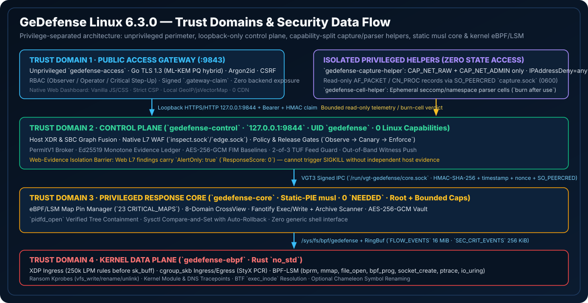

# GeDefense Linux 6.3.0 — Security Architecture Overview

> This document summarizes the 7-tier, 4-domain architecture of GeDefense Linux `6.3.0`. For the complete formal symbol tree and subsystem specification, see [`../ARCHITECTURE.md`](../ARCHITECTURE.md).

  

---

## 1. Seven-Tier Sovereign Defense Fabric

| Tier | Component / Process | Language & Runtime | Key Responsibilities |
|---:|---|---|---|
| **1** | **Public Access Gateway** (`gedefense-access`) | Go · TLS 1.3 (ML-KEM PQ hybrid) | Public HTTPS perimeter (`:9843`), Argon2id auth, CSRF sync-tokens, RBAC roles, `.gateway-claim` HMAC headers |
| **2** | **Command Center Web UI** | Vanilla JS/CSS · `0` CDN dependencies | Multi-language operator console (`DE`/`EN`/`RU`/`ZH-CN`), strict CSP, no `innerHTML`/`eval`, local GeoIP/SVG |
| **3** | **Control Plane** (`gedefense-control`) | Go (`127.0.0.1:9844`, `0` capabilities) | Host XDR, SBC Graph Fusion, L7 WAF (`edge.sock`/`inspect.sock`), FIM/Chronos, Ed25519 Ledger, Policy & Release Gates, TUF & Witness |
| **3b** | **Isolated Helpers** (`capture-helper`, `cell-helper`) | Go (`CAP_NET_RAW/ADMIN`, `no AF_INET`) & Rust (`seccomp`/cgroup) | Unshared packet/CN_PROC telemetry streaming (`capture.sock`) & burn-after-use parser sandboxes |
| **4** | **Privileged Response Core** (`gedefense-core`) | Rust (`static-pie` musl, `0 NEEDED`, `/run/vgt-gedefense/core.sock`) | HMAC-VGT3 IPC, pinned eBPF map custody, Fanotify exec/write + archive inspection, `pidfd` containment, AES-256-GCM Quarantine Vault, sysctl CAS |
| **5** | **Kernel Data Plane** (`gedefense-ebpf`) | Rust `no_std` (eBPF/XDP + BPF-LSM + Kprobes + Tracepoints) | XDP 250k-entry LPM drops prior to `sk_buff`, `cgroup_skb` RX/TX, `bprm`/`mmap`/`file_open`/`bpf_prog`/`io_uring`/`ptrace` hooks, `SEC_CRIT_EVENTS` ring |
| **6** | **Distribution & OS Integration** | Universal Linux (`APT`/`DNF`/`pacman`/`Zypper`) & AstraeaOS | Hardened systemd units, Polkit helpers, local desktop tray (Qt 6 + SPKI pin), AstraeaOS native ring-1 cell binding |
| **7** | **Release & Supply-Chain Integrity** | `TOOLCHAINS.lock` + Ed25519 + SPDX SBOM | Deterministic archives, signed `release-manifest.signed.json` & `release-index.signed.json`, 10-stage static security audit |

---

## 2. Trust Domain Isolation & Data Flow Invariants

1. **Zero Cloud Control Plane:** Operational keys, threat intelligence indexes, baselines, alerts, and encrypted forensic ledgers remain strictly on the protected host.
2. **Unprivileged Control Plane & Helper Separation:** `gedefense-control.service` runs as unprivileged `gedefense` with `CapabilityBoundingSet=`. Raw `AF_PACKET` and `CN_IDX_PROC` capture lives exclusively inside `gedefense-capture-helper.service` (`IPAddressDeny=any`, no `/etc/vgt/gedefense` or `core.sock` access).
3. **Static-PIE musl Privileged Core:** `gedefense-core` carries zero dynamic `NEEDED` libraries, preventing `LD_PRELOAD` or glibc injection against privileged enforcement routines. Communication with Control flows exclusively over `/run/vgt-gedefense/core.sock` with `SO_PEERCRED` + HMAC-SHA-256 + timestamp + nonce replay cache.
4. **Web-Evidence Isolation Barrier:** HTTP/L7 findings from the native Go WAF are strictly marked `AlertOnly: true` (`ResponseScore: 0`). A Layer-7 or regex match can **never** unilaterally trigger host process termination (`SIGSTOP`/`SIGKILL`). Destructive host containment requires independent kernel/host behavioral evidence validated in the Rust broker.
5. **Reversible Mutation Guarantee:** Kernel sysctl hardening uses typed compare-and-set with kernel readback and automatic rollback on partial failure. `Observe → Canary → Enforce` gating prevents active blocking before allowlists and core IPC attestations synchronize.

---

## 3. Related Specifications

- **Full Formal Spec (`4,400+` lines):** [`../ARCHITECTURE.md`](../ARCHITECTURE.md)
- **Anti-Spyware Planes (`AP-0`–`AP-9`):** [`ANTISPYWARE.md`](ANTISPYWARE.md)
- **Trust Model, Threat Surface & Limits:** [`SECURITY-MODEL.md`](SECURITY-MODEL.md)
- **Point 1–5 Deep Architecture Notes:** [`POINT1-TITAN-EXEC-GATE.md`](POINT1-TITAN-EXEC-GATE.md) · [`POINT2-PARSER-CELLS.md`](POINT2-PARSER-CELLS.md) · [`POINT3-EGRESS-BEACON.md`](POINT3-EGRESS-BEACON.md) · [`POINT4-WITNESS.md`](POINT4-WITNESS.md) · [`POINT5-LOCKDOWN.md`](POINT5-LOCKDOWN.md)
